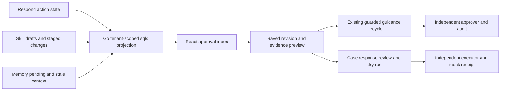

# Unified approval inbox

The local/mock inbox at `/respond/inbox` projects pending work from Respond,
Skills and Memory. It reuses the existing React 19/Chakra workspace and Go/sqlc
stores. It adds no datastore, migration, provider integration, queue or independent
approval state.

## Analyst workflow

1. Open **Respond → Approval inbox**. Filter by area, review/execution stage or
   proposal title/ID. Pagination is deterministic within each database snapshot.
2. Preview a saved revision: author and pending contributors, prior approval,
   content, staged changes, source-outcome provenance and evidence references.
3. Check the next required role and expiry. The signed-in operator is compared
   against the recorded authors and, for execution, the previous approver.
4. Review Memory or staged/source-change guidance through the existing lifecycle
   control in the preview. Publish a new Skill from its saved draft in Skills.
   Open the case for sandbox response approval, dry run and explicit execution.
5. Hand off to a distinct configured operator using the existing sign-in control.
   Refresh the inbox after completing work. A handoff is a navigation/identity
   instruction: it sends no message, changes no assignment and grants no rights.

The first release covers editable draft/staged/source-stale Skills, pending or
source-stale/expired Memory, and **case-linked mock session responses**. Executed
responses, archived guidance and current approved guidance are excluded. Legacy
remediation records, standalone sandbox actions, runbook checklist acknowledgements
and L1 mock-note approval are not a second queue in this inbox; their original
workspaces remain authoritative.

## Contract and implementation

`GET /api/v1/approvals` accepts `kind=all|respond|skill|memory`,
`stage=all|review|execution`, `search` (up to 200 characters), `limit` (1–50,
25 by default) and `offset` (0–1,000,000). Unknown and duplicate parameters fail
with 400; tenant identity comes exclusively from authenticated request context.

The response contains `items`, filtered `total`, global pending-stage `counts`,
`as_of`, `limit`, `offset` and `mode: local/mock`. Each item contains kind/ID/title,
saved document, stage, timestamp, expiry and source-change flag. Response IDs are
scoped by connector and source as well as tenant; the frontend uses that complete
identity for selection. All projected records and source checks use the same
PostgreSQL statement snapshot.

- `backend-go/internal/modules/investigations/queries/approval_inbox.sql`: scoped
  union and pagination, generated through sqlc.
- `backend-go/internal/modules/approvals/inbox.go`: validated read-only projection.
- `backend-go/internal/transport/httpapi/approval_inbox.go`: authenticated HTTP route.
- `frontend/src/ApprovalInbox.jsx`: filters, previews, accessible selection and
  existing lifecycle controls.
- `frontend/src/approvalInbox.js`: presentation-only expiry and handoff helpers.
- `frontend/src/GuidanceLifecycle.jsx`: blocks review if the latest fetched version
  differs from the displayed proposal revision. Refresh before further review.

No new approval mutation endpoint exists. Owner APIs still lock and validate the
current revision, independent identity, source evidence, scope grant, expiry and
policy. Preview eligibility is not execution authorization. Source content is
rendered as text, never HTML or agent instructions.

## Expiry and freshness

Response approval expiry moves a response back to approver review; a fresh approval
shows an executor handoff even if the kill switch remains stopped. The stopped gate
is explicitly displayed. The executor must preview the target and pass all existing
guards before confirming. Memory validity expiry requires a proposer to update the
record, then independent approval. Skills have no fabricated approval deadline.

Expiry labels and handoff hints update on the client clock; server timestamps and
owner checks are authoritative. Counts and stage filtering reflect `as_of`, not a
live subscription. Refresh after changes or elapsed expiry. Concurrent inserts can
shift offset pagination between requests; this is not a durable work-claim queue.

## Acceptance and limits

- Go integration: draft/staged/approved transitions, preview versions, Memory expiry
  and archive, pagination and foreign-tenant exclusion.
- HTTP acceptance: response proposal → approval → expiry → renewal → execution
  visibility; foreign-tenant denial; learned guidance → approval → source change.
- Frontend helpers: expired approval rerouting, exact expiry boundary, unknown
  authorship, contributor exclusions, separate executor and composite identity.
- Browser: filters, content/evidence preview, guarded author review, navigation,
  empty/error state and responsive layout. No real credentials are transferred to
  browser automation; authenticated flows run in the local API acceptance suite.

Large-catalog latency, production identity provisioning, notifications/assignment,
real providers and real-model quality remain separate gates. This feature makes no
production performance claim. Rollback removes the read-only route and UI entry;
existing approval state and audit history remain owned by the original workflows.

## Verified local results — 2026-11-01

- Full disposable Detect-to-Build acceptance: **passed**, one run in **189.87s**;
  report at `output/platform-acceptance/report.json`. Includes Go race tests,
  authenticated API transitions and tenant-negative checks. The report records
  base commit `13506d3` plus the uncommitted inbox working tree.
- Frontend lint and production build passed; **13 frontend test files passed**.
  The existing Vite bundle-size warning remains (main bundle approximately 1,013 KB).
- sqlc generated-query consistency, Python syntax and whitespace checks passed.
- `scripts/framework/approval-inbox-browser.js` passed on the refreshed local
  backend: stale-preview race denial, author approval disabled, Skill navigation,
  area/search filters, empty/error recovery, desktop and 390px mobile layout,
  with zero page errors. It uses no operator credentials and retains synthetic
  draft Skill/Memory fixtures. Screenshots are under ignored `output/playwright/`.

Authenticated role handoffs are verified by the local API suite; the browser smoke
covers anonymous author/denial behavior only. No production performance, live
provider operation or external notification was tested or enabled.
