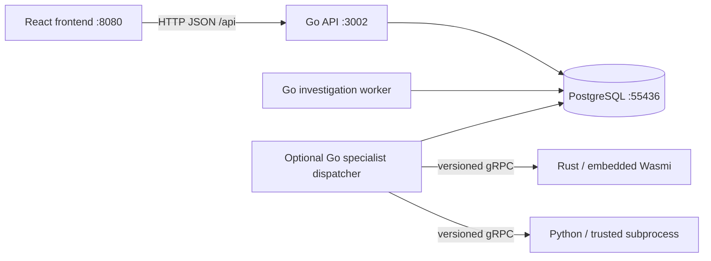

# Application architecture

Current as of 2026-10-29. Go/PostgreSQL is active; Node is retained for comparison
and rollback. The frontend remains React/Chakra/Vite.

Normal investigations use the local domain worker; specialist jobs use separate
optional services. Ordinary routes need neither Rust nor Python. Specialist jobs
remain disabled in the release during the legacy rollback window.

## Code and process boundaries

| Path/process | Responsibility |
|---|---|
| `backend-go/cmd/api` | HTTP lifecycle, readiness and domain API |
| `backend-go/cmd/investigation-worker` | Durable local investigation phases |
| `backend-go/cmd/worker` | Optional job leases and RPC dispatch |
| `backend-go/cmd/migrate` | Checksum-verified PostgreSQL migrations |
| `backend-go/cmd/data-migrate` | Snapshot import, reconciliation and reverse export |
| `backend-go/internal/transport/httpapi` | Parameter/body validation and HTTP errors |
| `backend-go/internal/modules` | Investigations, detection, intake, response, Skills, hunts, connectors, intelligence |
| `backend-go/internal/platform` | Auth, config, database, jobs and RPC |
| `contracts/proto`, `contracts/plugins.json` | Worker wire contract and resource limits |
| `services/wasm-worker`, `services/python-worker` | Optional specialists |
| `scripts/runtime` | Lifecycle, monitoring, backup/restore and rollback |

Domain modules share transactions rather than calling each other over HTTP.
Go owns authorization, business state, approvals and audits. Specialists receive
no database credentials.

## Persistence and concurrency

PostgreSQL uses typed columns, JSONB documents, composite tenant keys and scoped
indexes. Mutations and audits commit together. Row locks serialize conflicting
case/response/Skills updates; multi-query projections use repeatable-read snapshots
where required. See the [physical and logical data model](DATA_MODEL.md).

Investigation create/patch batch ordered SQL commands within their transactions.
Audit failure still rolls back prior commands. Typed detail responses avoid an
internal JSON encode/decode cycle. Skills aliases are loaded lazily and reused
within one application call. Mutable cases, permissions and credentials are not
cached across requests. pgx reuses prepared statements; durable commit and fsync
remain enabled. See [performance evidence](migration/PERFORMANCE.md).

Intake atomically validates/deduplicates alerts, applies routing and creates
case/job records. Three resumable phases record supplied evidence, compare
tenant-local active indicators and record review outcomes. Failed phases retain
committed progress and require explicit retry. Concurrent workers and SIGKILL
recovery are tested. Processing remains deterministic and local.

Specialist jobs use leases, attempts, bounded retries, cancellation and identity
checks. Expired, cancelled, foreign or superseded attempts cannot commit. An
already-running RPC remains bounded by its deadline; cancellation does not promise
immediate interruption of every underlying operation.

## Security and specialist limits

- Local auth is for development. Token mode binds tenant identity to an operator
  or session; source keys authorize intake only.
- Browser mutations require CSRF/origin checks. Sessions are memory-backed and
  invalidated on restart. SSO and granular RBAC remain future work.
- Connector secrets use tenant/record-bound authenticated encryption. Recovery
  needs the private key as well as the database dump.
- RPC uses a credential on literal loopback, a five-second deadline and 64 KiB
  input/output limits. Remote worker deployment requires a separate TLS design.
- Rust provides hashing and embedded Wasmi with fuel, one-page memory and no host imports.
- Python runs trusted allowlisted code in a limited child process, not arbitrary uploaded code.

## Frontend

`frontend/src/main.jsx` owns shell/navigation/client routing. Dedicated components
implement investigations, detection, Skills, API sources and response authoring.
`src/api.js` is the transport boundary; `theme.js` and `app.css` define styling.
Editable assets live in `public/`; generated bundles and `app.html` stay in `dist/`.

Vite proxies same-origin `/api` and `/health` to `AISOC_API_PROXY_TARGET`.
API-backed workflows show persisted state. Some dashboard/Memory content remains
demonstration-only. Stored queries and simulated actions are not live provider
execution. Current browser/mobile limits are recorded in [testing](TESTING.md).

## Runtime and recovery

| Stack | API | Frontend | Database |
|---|---:|---:|---|
| Active release | 3002 | 8080 | PostgreSQL 55436, `.run/go-runtime/` |
| Optional development | 3003 | 8081 when started | PostgreSQL 55435, `.run/go-dev/` |
| Optional Node comparison | 3004 | 8082 | Separate SQLite in `.run/node-compare/` |

Only the release starts through `run.sh`. Stop preserves data. All 26 legacy
tables reconciled at cutover. Post-write rollback reverse-exports current Go data
into a new SQLite database; restarting the old snapshot loses acknowledged writes.

[Operations](migration/OPERATIONS.md) covers settings, backups and rollback.
[ADR 002](adr/002-go-backend-replacement.md) records the architecture choice;
[ADR 003](adr/003-replacement-contract-decisions.md) defines compatibility limits.
Live integrations and enterprise deployment remain [roadmap work](FEATURE_ROADMAP.md).
