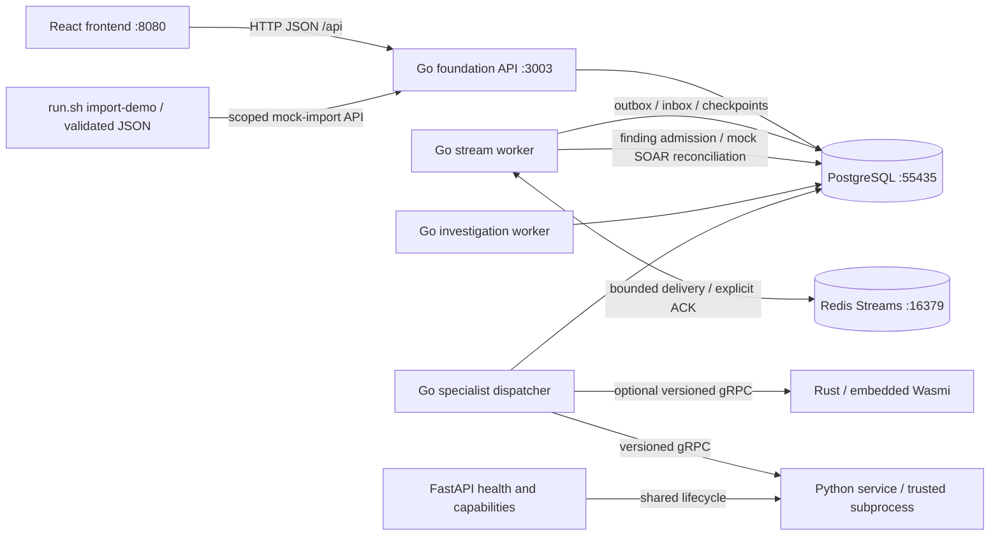
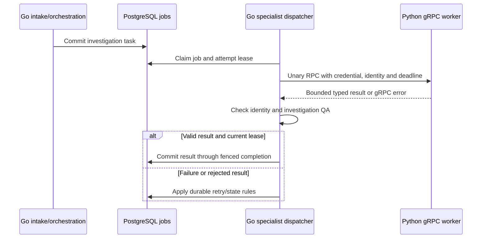

# Application architecture

Current as of 2026-10-30. Go/PostgreSQL is active; Node is retained for comparison
and rollback. The frontend remains React/Chakra/Vite.

This diagram describes the selected local foundation. The preserved release uses
API 3002 and PostgreSQL 55436; switching profiles never merges data. Normal domain
investigations use the local Go worker. The L1 sandbox dispatches typed mock inference
to the independent Python FastAPI/gRPC service. Rust remains an optional specialist;
there is no measured reason to move this bounded login correlation into Rust.

## Code and process boundaries

| Path/process | Responsibility |
|---|---|
| `backend-go/cmd/api` | HTTP lifecycle, readiness and domain API |
| `backend-go/cmd/investigation-worker` | Durable local investigation phases |
| `backend-go/cmd/worker` | Optional job leases and RPC dispatch |
| `backend-go/cmd/stream-worker` | Bounded source delivery, recovery, correlation and mock SOAR synchronization |
| `backend-go/cmd/migrate` | Checksum-verified PostgreSQL migrations |
| `backend-go/cmd/data-migrate` | Snapshot import, reconciliation and reverse export |
| `backend-go/internal/transport/httpapi` | Parameter/body validation and HTTP errors |
| `backend-go/internal/modules` | Investigations, detection, intake, response, Skills, hunts, connectors, intelligence |
| `backend-go/internal/platform` | Auth, config, database, jobs and RPC |
| `contracts/proto`, `contracts/plugins.json` | Worker wire contract and resource limits |
| `services/wasm-worker`, `services/python-worker` | Optional specialists |
| `scripts/runtime` | Lifecycle, monitoring, backup/restore and rollback |
| `scripts/framework/import_demo.py` | Validated all/selected demo imports via Go; no direct SQL insertion |

Domain modules share transactions rather than calling each other over HTTP.
Go owns authorization, business state, approvals and audits. Specialists receive
no database credentials.

## REST, gRPC and asynchronous work

| Boundary | Current transport | Owner and purpose |
|---|---|---|
| Browser / demo importer → Go | HTTP JSON on API 3003 | Authentication, tenant/source scope, validation and durable intake |
| Go → Python | Unary gRPC on loopback 50051 | Typed specialist execution and investigation requests |
| Go → optional Rust worker | Unary gRPC at the configured loopback address | Hashing and bounded WASM plugins; not a telemetry engine |
| Python management | FastAPI HTTP on loopback 8001 | Liveness, readiness and authenticated capabilities; no execution route |
| Accepted telemetry → consumers | Redis Streams with PostgreSQL outbox/inbox | Buffered delivery, replay and commit-before-ACK |
| Investigation scheduling | PostgreSQL jobs and Go dispatcher | Durable leases, retries and result admission |

FastAPI and Python gRPC share one independently supervised process. FastAPI lifespan
starts/drains gRPC; Go calls gRPC directly, not an HTTP-to-gRPC proxy. The generic
[Worker contract](../contracts/proto/aisoc/worker/v1/worker.proto) supplies
`Execute`; the typed [Investigator contract](../contracts/proto/aisoc/worker/v1/investigation.proto)
supplies `Investigate`. Both belong to `aisoc.worker.v1`; neither uses application
streaming. Generic plugin input/output is a bounded byte payload, while investigation
evidence, hypotheses and results have explicit Protobuf fields.

| Safeguard | Implemented behavior |
|---|---|
| Service authentication | Bearer metadata; Go replaces caller-supplied authorization. Python uses constant-time comparison and rejects duplicate credentials |
| Transport security | Literal loopback only, plaintext gRPC. TLS/mTLS and remote service identity are not implemented |
| Execution time | Go caps execution at five seconds; an earlier task/caller deadline wins. Normalization subprocesses have a separate three-second bound |
| Payload limits | Generic input/output: 65,536 bytes; wire messages: 70,000 bytes. Investigation tasks/results are further bounded to 16 KiB and at most 16 evidence items |
| Admission | Python admits at most four concurrent RPCs, including health; overload is rejected |
| Result ownership | Tenant/job/task/attempt identity and investigation evidence checks in Go; stale or cancelled jobs cannot commit results |
| Recovery | PostgreSQL owns application retries. No automatic execution retry policy is configured at the RPC layer |
| Health/lifecycle | Authenticated unary standard health, HTTP readiness, graceful shutdown and reconnect tests. Core API readiness does not depend on optional workers |

The current [Go dispatcher](../backend-go/cmd/worker/main.go) executes one claimed
job at a time per process. Python's four RPC slots therefore do not imply four
parallel investigations in this launcher. Channels are retained by plugin clients;
channel reuse does not provide application-level dispatch concurrency.

gRPC supplies shared generated contracts and explicit deadlines/statuses for internal
workers. REST remains the frontend and vendor-integration boundary. No equivalent
REST-versus-gRPC benchmark has established a speedup here; gRPC does not solve
PostgreSQL commit/storage bottlenecks or confer stronger security by itself.
Read [developer implementation guidance](DEVELOPMENT.md#working-with-grpc-workers)
for code locations and verification.

Before distributed or real-model production use, address bounded dispatcher
concurrency, workload-specific deadlines, TLS/mTLS and credential rotation,
per-RPC metrics/tracing, multi-worker routing and contract compatibility policy.
The investigation validators reject unknown fields, so additive Protobuf changes
must not be assumed compatible without coordinated validation tests. Cancellation
bounds result acceptance but does not guarantee immediate termination of an
underlying model HTTP request. Demo inference remains explicitly mocked.

## Persistence and concurrency

The local foundation runs migrations through 030 (48 tables), including durable
source checkpoints, retained envelopes, outbox/inbox, retries/DLQ, investigation
state, archive references and transactional payload-budget counters. Redis buffers
delivery; PostgreSQL commits effects before ACK. Publication receipts use bounded
pipelined updates with consistent row-lock ordering and lease fencing. The single
SQL receipt experiment was reverted after inconsistent benchmark results.
See [streaming persistence](STREAMING_PERSISTENCE.md), [Redis transport](REDIS_STREAMS.md)
and [measured performance](STREAM_PERFORMANCE_REPORT.md). Live provider polling and
production response activation remain outside this local scope.

PostgreSQL uses typed columns, JSONB documents, composite tenant keys and scoped
indexes. Mutations and audits commit together. Row locks serialize conflicting
case/response/Skills updates; multi-query projections use repeatable-read snapshots
where required. See the [physical and logical data model](DATA_MODEL.md).

The agreed next data-access standard is **sqlc + pgx for PostgreSQL**, but sqlc
generation has not yet been introduced: current stores use handwritten parameterized
pgx queries. Redis continues to use go-redis; sqlc does not generate Redis operations.
Domain methods may compose cache and database adapters while keeping their distinct
transaction, expiry and ACK semantics explicit. The PostgreSQL outbox remains the
coordination boundary; adopting sqlc will not create a cross-store transaction.

Investigation create/patch batch ordered SQL commands within their transactions.
Audit failure still rolls back prior commands. Typed detail responses avoid an
internal JSON encode/decode cycle. Skills aliases are loaded lazily and reused
within one application call. Mutable cases, permissions and credentials are not
cached across requests. pgx reuses prepared statements; durable commit and fsync
remain enabled. See [performance evidence](migration/PERFORMANCE.md).

Intake atomically validates/deduplicates alerts, applies routing and creates
case/job records. Three resumable phases record supplied evidence, compare
tenant-local active indicators and record review outcomes. Failed phases retain
committed progress and require explicit retry. Concurrent workers and SIGKILL
recovery are tested. Processing remains deterministic and local.

Specialist jobs use leases, attempts, bounded retries, cancellation and identity
checks. Expired, cancelled, foreign or superseded attempts cannot commit. An
already-running RPC remains bounded by its deadline; cancellation does not promise
immediate interruption of every underlying operation.

## Security and specialist limits

- Local auth is for development. Token mode binds tenant identity to an operator
  or session; source keys authorize intake only.
- Requests carrying Origin must match the configured allowlist before authentication
  or public handlers, including local mode; empty/duplicate Origin headers are rejected.
  Requests without Origin remain supported for non-browser clients. This is not a
  replacement for authentication, TLS, or host/network access controls.
- Browser mutations require CSRF/origin checks. Sessions are memory-backed and
  invalidated on restart. SSO and granular RBAC remain future work.
- Connector secrets use tenant/record-bound authenticated encryption. Recovery
  needs the private key as well as the database dump.
- RPC uses a credential on literal loopback, a five-second deadline and 64 KiB
  input/output limits. Remote worker deployment requires a separate TLS design.
- Rust provides hashing and embedded Wasmi with fuel, one-page memory and no host imports.
- Python runs trusted allowlisted code in a limited child process, not arbitrary uploaded code.
- Python includes an independent FastAPI/gRPC service in the development
  framework. HTTP exposes health/readiness/capabilities; Go dispatches work over
  gRPC. Enable via `dev.py start --python-worker`; this does not change the release.
  See [ADR 004](adr/004-python-fastapi-grpc-service.md) and the
  [Python guide](../services/python-worker/README.md).

## Frontend

`frontend/src/main.jsx` owns shell/navigation/client routing. Dedicated components
implement investigations, detection, Skills, API sources and response authoring.
`src/api.js` is the transport boundary; `theme.js` and `app.css` define styling.
Editable assets live in `public/`; generated bundles and `app.html` stay in `dist/`.

Vite proxies same-origin `/api` and `/health` to `AISOC_API_PROXY_TARGET`.
API-backed workflows show persisted state. Some dashboard/Memory content remains
demonstration-only. Stored queries and simulated actions are not live provider
execution. Current browser/mobile limits are recorded in [testing](TESTING.md).

## Runtime and recovery

| Stack | API | Frontend | Database |
|---|---:|---:|---|
| Selected foundation/showcase | 3003 | 8080 | PostgreSQL 55435, `.run/go-dev/` |
| Preserved release | 3002 | 8080 only when release profile selected | PostgreSQL 55436, `.run/go-runtime/` |
| Optional Node comparison | 3004 | 8082 | Separate SQLite in `.run/node-compare/` |

The supervised development foundation starts with
`AISOC_RUNTIME_PROFILE=foundation ./run.sh start both`.
Its Python service listens on HTTP 8001 and gRPC 50051, with the Go specialist
dispatcher sharing the development database. Python receives no database or
connector credentials. Rust is not started by this option. The main frontend uses
one API target for every page; the foundation profile exposes the demo on 8080.

`run.sh` selects `release` or `foundation` through `.run/runtime-profile` or
`AISOC_RUNTIME_PROFILE`. Foundation mode manages its supervisor. Stop the frontend
before changing profiles. `/build-operations` aliases `/build/stream-operations`.
Stop preserves data. All 26 legacy
tables reconciled at cutover. Post-write rollback reverse-exports current Go data
into a new SQLite database; restarting the old snapshot loses acknowledged writes.

[Operations](migration/OPERATIONS.md) covers settings, backups and rollback.
[ADR 002](adr/002-go-backend-replacement.md) records the architecture choice;
[ADR 003](adr/003-replacement-contract-decisions.md) defines compatibility limits.
Live integrations and enterprise deployment remain [roadmap work](FEATURE_ROADMAP.md).

## Demo import boundary

`run.sh import-demo all` loads the 10,000-event showcase plus the configured
benchmark bundle (currently 60,000 events). `showcase` loads only the built-in
showcase; `files` selects manifest-listed JSON files. `--dry-run` validates without
starting services or changing grants/data. The importer checks bundle hashes and
bindings before mutations, preserves existing grants and adds only selected scopes.
New grants require an automatic foundation restart; existing grants do not. Files
are sent in 100-event batches through Go with current checkpoints and durable dedup.
Scope configuration stays private under `.run/`; artifacts stay in ignored `output/`.
The importer never enables live providers or privileged response execution.
See [demo commands and format](BENCHMARK_DATA_IMPORT.md).

S04 adds [stream recovery primitives](STREAMING_RECOVERY.md): durable retries/DLQ,
bounded publication, consumer fencing and retained-event reconciliation. These are
not scheduled by the core API; live ingestion remains disabled.

S05 adds a [bounded mock QRadar flow](MOCK_QRADAR_FLOW.md). Go correlates an
authoritative event-time snapshot into review-only findings; a separate pure
SOAR reducer checks revision transitions. S05 alone does not persist findings or
admit investigation jobs; S06 adds that path below. Python FastAPI/gRPC remains the inference boundary;
this deterministic rule does not require model calls or a new Rust service.

S06 extends that mock flow with [durable finding admission](FINDING_ADMISSION.md),
reusing the existing alert/case/job transaction and local worker. Canonical receipts
prevent duplicate cases; per-tenant budgets and scheduling bound stream-admitted
work. This was initially opt-in; it is now deployed in the local foundation's mock
flow, while the preserved release remains separate. S07 adds the Python/QA boundary below.

S07 adds [typed mock investigation and QA](L1_INVESTIGATION.md) to the independent
Python FastAPI/gRPC service. Go builds bounded evidence tasks, queues explicit mock
jobs, owns deadlines/leases and vetoes invalid output before persistence. Results
are inconclusive and require review; S08 adds the note-only mock path below.

S08 adds [audited L2-review records and mock SOAR notes](MOCK_SOAR_RECONCILIATION.md).
Go revalidates completed jobs, preserves analyst-owned fields and fences note append
by source version. Conflicts require explicit reconciliation; no live provider
write-back or automatic response is enabled.

S09 adds an [opt-in local IOC cache](ENRICHMENT_CACHE.md) for Go-owned enrichment.
PostgreSQL generations invalidate positive/negative Redis entries; cache failures
fall back to source reads. Existing processing remains uncached pending measurement.

S10 adds [scoped accounting and explicit Redis retention](STREAM_OPERATIONS.md).
[Measured probes](STREAM_PERFORMANCE_REPORT.md) fell short of nominal 1,000 offered
EPS and showed no useful local IOC cache benefit. Live rollout remains gated by
profiling, capacity, operational monitoring and durable-retention work.

## Current JSON sandbox milestone

See [sandbox completion and operations](SANDBOX_COMPLETION.md) for scoped JSON
intake, independent Python FastAPI/gRPC, recovery UI, monitoring, verified archive
export, startup and measured limits. Earlier task entries are historical checkpoints.
Live vendor/model validation and privileged response activation are outside this
user-selected local release.
