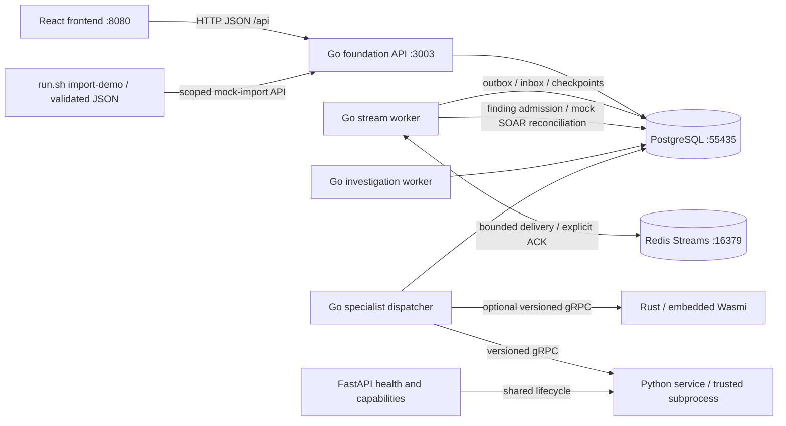
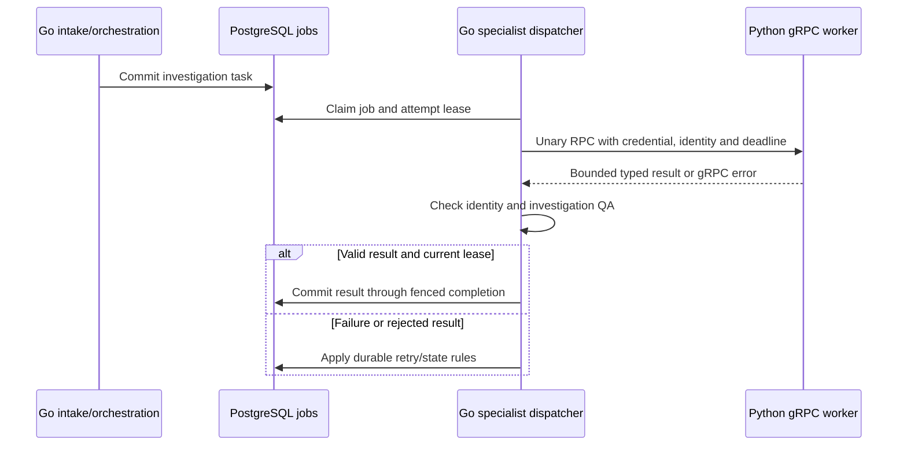

# Application architecture

Current approval contract: [independent proposer, approver and executor roles](INDEPENDENT_APPROVAL_ROLES.md). Outcome learning saves proposals; Memory requires independent approval before reuse, and responses require three distinct operators.

[Outcome learning](SKILLS_MEMORY_OUTCOMES.md) adds a Go-owned approval transaction across existing Skills and Memory stores. Migration 045 retains immutable evidence/outcome receipts; existing application matching and snapshots remain the only runtime path.

The [Threat Intel → Hunt → Investigate flow](INTEL_HUNT_INVESTIGATE.md) uses Go validation and sqlc/pgx transactions. Migration 044 adds import and promotion receipts. Saved hunt findings become open/unknown cases with an evidence artifact and audit atomically; Redis, Python and Rust are not involved in this bounded local path.

Current as of 2026-10-31. Go/PostgreSQL is active; Node is retained for comparison
and rollback. The frontend remains React/Chakra/Vite.

This diagram describes the selected local foundation. The preserved release uses
API 3002 and PostgreSQL 55436; switching profiles never merges data. Normal domain
investigations use the local Go worker. The L1 sandbox dispatches typed mock inference
to the independent Python FastAPI/gRPC service. Rust remains an optional specialist;
there is no measured reason to move this bounded login correlation into Rust.

## Code and process boundaries

| Path/process | Responsibility |
|---|---|
| `backend-go/cmd/api` | HTTP lifecycle, readiness and domain API |
| `backend-go/cmd/investigation-worker` | Durable local investigation phases |
| `backend-go/cmd/worker` | Optional job leases and RPC dispatch |
| `backend-go/cmd/stream-worker` | Bounded source delivery, recovery, correlation and mock SOAR synchronization |
| `backend-go/cmd/migrate` | Checksum-verified PostgreSQL migrations |
| `backend-go/cmd/data-migrate` | Snapshot import, reconciliation and reverse export |
| `backend-go/internal/transport/httpapi` | Parameter/body validation and HTTP errors |
| `backend-go/internal/modules` | Investigations, detection, intake, response, Skills, hunts, connectors, intelligence |
| `backend-go/internal/platform` | Auth, config, database, jobs and RPC |
| `contracts/proto`, `contracts/plugins.json` | Worker wire contract and resource limits |
| `services/wasm-worker`, `services/python-worker` | Optional specialists |
| `scripts/runtime` | Lifecycle, monitoring, backup/restore and rollback |
| `scripts/framework/import_demo.py` | Validated all/selected demo imports via Go; no direct SQL insertion |

Domain modules share transactions rather than calling each other over HTTP.
Go owns authorization, business state, approvals and audits. Specialists receive
no database credentials.

## REST, gRPC and asynchronous work

| Boundary | Current transport | Owner and purpose |
|---|---|---|
| Browser / demo importer → Go | HTTP JSON on API 3003 | Authentication, tenant/source scope, validation and durable intake |
| Go → Python | Unary gRPC on loopback 50051 | Typed specialist execution and investigation requests |
| Go → optional Rust worker | Unary gRPC at the configured loopback address | Hashing and bounded WASM plugins; not a telemetry engine |
| Python management | FastAPI HTTP on loopback 8001 | Liveness, readiness and authenticated capabilities; no execution route |
| Accepted telemetry → consumers | Redis Streams with PostgreSQL outbox/inbox | Buffered delivery, replay and commit-before-ACK |
| Investigation scheduling | PostgreSQL jobs and Go dispatcher | Durable leases, retries and result admission |

FastAPI and Python gRPC share one independently supervised process. FastAPI lifespan
starts/drains gRPC; Go calls gRPC directly, not an HTTP-to-gRPC proxy. The generic
[Worker contract](../contracts/proto/aisoc/worker/v1/worker.proto) supplies
`Execute`; the typed [Investigator contract](../contracts/proto/aisoc/worker/v1/investigation.proto)
supplies `Investigate`. Both belong to `aisoc.worker.v1`; neither uses application
streaming. Generic plugin input/output is a bounded byte payload, while investigation
evidence, hypotheses and results have explicit Protobuf fields.

| Safeguard | Implemented behavior |
|---|---|
| Service authentication | Bearer metadata; Go replaces caller-supplied authorization. Python uses constant-time comparison and rejects duplicate credentials |
| Transport security | Plaintext only on literal loopback; optional Go/Python mTLS with CA/SAN verification and client identity allowlist |
| Execution time | Go caps execution at five seconds; an earlier task/caller deadline wins. Normalization subprocesses have a separate three-second bound |
| Payload limits | Generic input/output: 65,536 bytes; wire messages: 70,000 bytes. Investigation tasks/results are further bounded to 16 KiB and at most 16 evidence items |
| Admission | Python admits at most four concurrent RPCs, including health; overload is rejected |
| Result ownership | Tenant/job/task/attempt identity and investigation evidence checks in Go; stale or cancelled jobs cannot commit results |
| Recovery | PostgreSQL owns application retries. No automatic execution retry policy is configured at the RPC layer |
| Health/lifecycle | Authenticated unary standard health, HTTP readiness, graceful shutdown and reconnect tests. Core API readiness does not depend on optional workers |

The [Go dispatcher](../backend-go/cmd/worker/main.go) defaults to two bounded
execution slots and one running lease per tenant. PostgreSQL tenant-row locks and
last-dispatch timestamps provide equal-turn selection across eligible tenants.
Channels are retained; jobs are claimed only when an execution slot is available.
See [dispatch and transport details](WORKER_DISPATCH_SECURITY.md).

gRPC supplies shared generated contracts and explicit deadlines/statuses for internal
workers. REST remains the frontend and vendor-integration boundary. No equivalent
REST-versus-gRPC benchmark has established a speedup here; gRPC does not solve
PostgreSQL commit/storage bottlenecks or confer stronger security by itself.
Read [developer implementation guidance](DEVELOPMENT.md#working-with-grpc-workers)
for code locations and verification.

Before distributed or real-model production use, address workload-specific deadlines,
automated certificate/credential rotation,
per-RPC metrics/tracing, multi-worker routing and contract compatibility policy.
The investigation validators reject unknown fields, so additive Protobuf changes
must not be assumed compatible without coordinated validation tests. Cancellation
bounds result acceptance but does not guarantee immediate termination of an
underlying model HTTP request. Demo inference remains explicitly mocked.

## Persistence and concurrency

The local foundation supports migrations through 032 (49 tables), including durable
source checkpoints, retained envelopes, outbox/inbox, retries/DLQ, investigation
state, archive references and transactional payload-budget counters. Redis buffers
delivery; PostgreSQL commits effects before ACK. Publication receipts use bounded
pipelined updates with consistent row-lock ordering and lease fencing. The single
SQL receipt experiment was reverted after inconsistent benchmark results.
See [streaming persistence](STREAMING_PERSISTENCE.md), [Redis transport](REDIS_STREAMS.md)
and [measured performance](STREAM_PERFORMANCE_REPORT.md). Live provider polling and
production response activation remain outside this local scope.

PostgreSQL uses typed columns, JSONB documents, composite tenant keys and scoped
indexes. Mutations and audits commit together. Row locks serialize conflicting
case/response/Skills updates; multi-query projections use repeatable-read snapshots
where required. See the [physical and logical data model](DATA_MODEL.md).

The first **sqlc + pgx for PostgreSQL** repository is `platform/jobs`: queries are
generated from versioned SQL and actual migrations. `modules/navigation` now also uses sqlc for tenant-scoped breadcrumb labels. Remaining stores retain
parameterized pgx queries for incremental migration. Redis continues to use go-redis; sqlc does not generate Redis operations.
Domain methods may compose cache and database adapters while keeping their distinct
transaction, expiry and ACK semantics explicit. The PostgreSQL outbox remains the
coordination boundary; sqlc does not create a cross-store transaction.

Investigation create/patch batch ordered SQL commands within their transactions.
Audit failure still rolls back prior commands. Typed detail responses avoid an
internal JSON encode/decode cycle. Skills aliases are loaded lazily and reused
within one application call. Mutable cases, permissions and credentials are not
cached across requests. pgx reuses prepared statements; durable commit and fsync
remain enabled. See [performance evidence](migration/PERFORMANCE.md).

Intake atomically validates/deduplicates alerts, applies routing and creates
case/job records. Three resumable phases record supplied evidence, compare
tenant-local active indicators and record review outcomes. Failed phases retain
committed progress and require explicit retry. Concurrent workers and SIGKILL
recovery are tested. Processing remains deterministic and local.

Specialist jobs use leases, attempts, bounded retries, cancellation and identity
checks. Expired, cancelled, foreign or superseded attempts cannot commit. An
already-running RPC remains bounded by its deadline; cancellation does not promise
immediate interruption of every underlying operation.

## Security and specialist limits

- Local auth is for development. Token mode binds tenant identity to an operator
  or session; source keys authorize intake only.
  Intake middleware resolves the source key to the stored tenant; `IngestSource`
  rechecks expiry/revocation and the key under a PostgreSQL row lock through commit.
  This prevents rotation/revocation racing the intake write. Local tenant selection
  rejects repeated or comma-joined tenant headers; local mode still permits explicit
  tenant selection and must not be exposed as a multi-tenant authentication service.
- Requests carrying Origin must match the configured allowlist before authentication
  or public handlers, including local mode; empty/duplicate Origin headers are rejected.
  Requests without Origin remain supported for non-browser clients. This is not a
  replacement for authentication, TLS, or host/network access controls.
- Browser mutations require CSRF/origin checks. Sessions are memory-backed and
  invalidated on restart. SSO and granular RBAC remain future work.
- Connector secrets use tenant/record-bound authenticated encryption. Recovery
  needs the private key as well as the database dump.
- RPC uses a credential on literal loopback, a five-second deadline and 64 KiB
  input/output limits. Optional Python mTLS is locally validated; production PKI
  and remote deployment remain separate operational work.
- Rust provides hashing and embedded Wasmi with fuel, one-page memory and no host imports.
- Python runs trusted allowlisted code in a limited child process, not arbitrary uploaded code.
- Python includes an independent FastAPI/gRPC service in the development
  framework. HTTP exposes health/readiness/capabilities; Go dispatches work over
  gRPC. Enable via `dev.py start --python-worker`; this does not change the release.
  See [ADR 004](adr/004-python-fastapi-grpc-service.md) and the
  [Python guide](../services/python-worker/README.md).

## Frontend

`frontend/src/main.jsx` owns shell/navigation/client routing. Dedicated components
implement investigations, detection, Skills, API sources and response authoring.
`src/api.js` is the transport boundary; `theme.js` and `app.css` define styling.
Editable assets live in `public/`; generated bundles and `app.html` stay in `dist/`.

Vite proxies same-origin `/api` and `/health` to `AISOC_API_PROXY_TARGET`.
Overview and Memory show tenant-scoped persisted data, with explicit empty/error
states. Stored queries and simulated actions are not live provider execution. Current browser/mobile limits are recorded in [testing](TESTING.md).

## Runtime and recovery

| Stack | API | Frontend | Database |
|---|---:|---:|---|
| Selected foundation/showcase | 3003 | 8080 | PostgreSQL 55435, `.run/go-dev/` |
| Preserved release | 3002 | 8080 only when release profile selected | PostgreSQL 55436, `.run/go-runtime/` |
| Optional Node comparison | 3004 | 8082 | Separate SQLite in `.run/node-compare/` |

The supervised development foundation starts with
`AISOC_RUNTIME_PROFILE=foundation ./run.sh start both`.
Its Python service listens on HTTP 8001 and gRPC 50051, with the Go specialist
dispatcher sharing the development database. Python receives no database or
connector credentials. Rust is not started by this option. The main frontend uses
one API target for every page; the foundation profile exposes the demo on 8080.

`run.sh` selects `release` or `foundation` through `.run/runtime-profile` or
`AISOC_RUNTIME_PROFILE`. Foundation mode manages its supervisor. Stop the frontend
before changing profiles. `/build-operations` aliases `/build/stream-operations`.
Stop preserves data. All 26 legacy
tables reconciled at cutover. Post-write rollback reverse-exports current Go data
into a new SQLite database; restarting the old snapshot loses acknowledged writes.

[Operations](migration/OPERATIONS.md) covers settings, backups and rollback.
[ADR 002](adr/002-go-backend-replacement.md) records the architecture choice;
[ADR 003](adr/003-replacement-contract-decisions.md) defines compatibility limits.
Live integrations and enterprise deployment remain [roadmap work](FEATURE_ROADMAP.md).

## Demo import boundary

`run.sh import-demo all` loads the 10,000-event showcase plus the configured
benchmark bundle (currently 60,000 events). `showcase` loads only the built-in
showcase; `files` selects manifest-listed JSON files. `--dry-run` validates without
starting services or changing grants/data. The importer checks bundle hashes and
bindings before mutations, preserves existing grants and adds only selected scopes.
New grants require an automatic foundation restart; existing grants do not. Files
are sent in 100-event batches through Go with current checkpoints and durable dedup.
Scope configuration stays private under `.run/`; artifacts stay in ignored `output/`.
The importer never enables live providers or privileged response execution.
See [demo commands and format](BENCHMARK_DATA_IMPORT.md).

Telemetry transactions, Redis reads/publication and ACK batches now share a
500-event maximum. Receipt updates lock sorted keys and join each event to its
attempt/message ID once, with atomic rollback on a stale lease. The HTTP body
limit remains 1 MiB; the demo loader still submits 100-event pages. Optional local
PostgreSQL tuning is allowlisted in `.run/go-dev/postgres-profile.json`; fsync,
synchronous commit and full-page writes remain mandatory in the foundation.
[Repeated performance validation](PERFORMANCE_GATE.md) verifies average throughput
above 1,000 EPS while retaining the failed latency-stability gate.

S04 adds [stream recovery primitives](STREAMING_RECOVERY.md): durable retries/DLQ,
bounded publication, consumer fencing and retained-event reconciliation. These are
not scheduled by the core API; live ingestion remains disabled.

S05 adds a [bounded mock QRadar flow](MOCK_QRADAR_FLOW.md). Go correlates an
authoritative event-time snapshot into review-only findings; a separate pure
SOAR reducer checks revision transitions. S05 alone does not persist findings or
admit investigation jobs; S06 adds that path below. Python FastAPI/gRPC remains the inference boundary;
this deterministic rule does not require model calls or a new Rust service.

S06 extends that mock flow with [durable finding admission](FINDING_ADMISSION.md),
reusing the existing alert/case/job transaction and local worker. Canonical receipts
prevent duplicate cases; per-tenant budgets and scheduling bound stream-admitted
work. This was initially opt-in; it is now deployed in the local foundation's mock
flow, while the preserved release remains separate. S07 adds the Python/QA boundary below.

S07 adds [typed mock investigation and QA](L1_INVESTIGATION.md) to the independent
Python FastAPI/gRPC service. Go builds bounded evidence tasks, queues explicit mock
jobs, owns deadlines/leases and vetoes invalid output before persistence. Results
are inconclusive and require review; S08 adds the note-only mock path below.

S08 adds [audited L2-review records and mock SOAR notes](MOCK_SOAR_RECONCILIATION.md).
Go revalidates completed jobs, preserves analyst-owned fields and fences note append
by source version. Conflicts require explicit reconciliation; no live provider
write-back or automatic response is enabled.

S09 adds an [opt-in local IOC cache](ENRICHMENT_CACHE.md) for Go-owned enrichment.
PostgreSQL generations invalidate positive/negative Redis entries; cache failures
fall back to source reads. Existing processing remains uncached pending measurement.

S10 adds [scoped accounting and explicit Redis retention](STREAM_OPERATIONS.md).
[Measured probes](STREAM_PERFORMANCE_REPORT.md) fell short of nominal 1,000 offered
EPS and showed no useful local IOC cache benefit. Live rollout remains gated by
profiling, capacity, operational monitoring and durable-retention work.

## Current JSON sandbox milestone

See [sandbox completion and operations](SANDBOX_COMPLETION.md) for scoped JSON
intake, independent Python FastAPI/gRPC, recovery UI, monitoring, verified archive
export, startup and measured limits. Earlier task entries are historical checkpoints.
Live vendor/model validation and privileged response activation are outside this
user-selected local release.

## React 19 frontend

The frontend uses React/React DOM 19.3.1 with Chakra UI 2.10.9 and selectively enabled React Compiler 1.0. See [migration, verification and rollback notes](REACT_19_MIGRATION.md) for pinned tooling, the telemetry opt-out, browser checks and measured limitations.

## Frontend navigation boundary

The shared `frontend/src/navigation.js` route configuration drives the desktop header, section submenus and mobile drawer. `/` belongs to Detect → Overview. Detail pages retain their section and submenu selection; native link semantics coexist with client-side navigation. Navigation does not grant API permissions or change Go authorization. See the [route map and component ownership](NAVIGATION.md).

Breadcrumb hierarchy comes from the shared frontend navigation map; bounded resource names come from a read-only Go endpoint using generated PostgreSQL queries. No cross-tenant name cache or schema migration is introduced. See [breadcrumb contract and ownership](BREADCRUMBS.md).

### Detection Intelligence screenshot implementation (2026-10-31)

Source/rule treemap, coverage and escalation views, search, linked-case drill-down, and responsive summary panels now use the tenant-scoped Go sqlc/pgx projection. Existing `/detect/intelligence` links remain valid; `/detect/detection-intelligence` is an alias. Coverage means linked alerts, not completed investigations. See [implementation, API, metric definitions and verification](DETECTION_INTELLIGENCE.md). Local Rule Recommendations and Detection Routing are now implemented; provider synchronization remains future work.

### Detection Rules workspace (2026-10-31)

The Rules screenshot layout now uses Go/sqlc period-specific metrics, a backend-served local catalog, and URL-persisted inspector selection, filters and tabs. Existing CRUD, audit and all-time APIs are retained. FP share now uses explicit analyst labels; assessed coverage and local recommendations have separate evidence-backed workflows. See [UI, API contracts, test workflow and rollback](DETECTION_RULES.md).

### Detection Coverage (2026-10-31)

The Coverage workspace now provides a pinned ATT&CK radar/table, technique drill-down and tenant-scoped, versioned analyst assessments. Migration 033 is additive; sqlc writes and audit commit together. Verified coverage excludes stale/expired reviews and non-detection decisions. The old Overview coverage example now links to the real workspace. See [reference provenance, denominator, APIs, testing and rollback](DETECTION_COVERAGE.md).

### Rule Recommendations (2026-10-31)

The Rules inspector now provides explicit analyst labels, deterministic proposals, local query validation, bounded replay receipts and version-checked apply/dismiss. Apply is limited to disabled, unbound local rules; provider sync remains unavailable. Migration 034 adds tenant-scoped labels and proposals with atomic audit. See [workflow, API, architecture, tests and rollback](RULE_RECOMMENDATIONS.md).

### Detection Routing (2026-11-01)

The Routing workspace adds ordered universal policies, per-rule defaults, entity lists/exceptions and audit history. Go previews bounded stored evidence before active changes and applies the same evaluator during local intake, preserving protected escalation and duplicate decisions. Migration 035 is additive; no quarantine or external provider actions are enabled. See [workflow, architecture, APIs, tests and rollback](DETECTION_ROUTING.md).

### Investigation workspace (2026-11-01)

The investigation detail now provides screenshot-inspired Summary, Report, Remediation, Artifacts graph/table and a private case evidence-lookup drawer. Existing L1 review, runbooks, feedback and action simulations remain available. Go supplies bounded provenance projections; migration 036 stores actor-scoped idempotent lookup messages with atomic audit. No model-backed conversation or external containment is implied. See [screens, APIs, architecture, limits, tests and rollback](INVESTIGATION_WORKSPACE.md).

## Respond workspace (2026-11-01)

React uses the existing case and versioned procedure APIs plus tenant-scoped Go workflow policy/preview endpoints. Migration 037 stores policy configuration, atomic policy history and dry-run receipts in PostgreSQL through sqlc/pgx. Policy updates lock the workflow and compare policy/plan versions; previews evaluate the stored policy against an owned case without executing instructions or changing case/action state. The canvas is a policy gate and linear steps, not a provider execution engine. See [flow and boundaries](RESPONSE_WORKSPACE.md).

## Hunt evidence search

Go owns bounded tenant-scoped literal search over stored cases/artifacts, request replay and transactional audit. Migration 038 persists search snapshots and analyst notes through sqlc/pgx. The UI separates current hunt input from historical receipt queries. Legacy simulated execution remains compatible but is not used by these screens. See [Hunt architecture and safety](HUNT_WORKSPACE.md).

## Threat Intel registry and local hunt links

Go uses a repeatable-read registry projection and the existing tenant TI mutation lock for report/IOC changes and atomic local hunt creation. Migration 039 adds analyst metadata and retained request/link snapshots. The draft hunt, link and hunt/report audits commit together; no provider execution occurs. Hunt deletion retains replay tombstones. See [architecture and contracts](THREAT_INTEL_WORKSPACE.md).

## Skills workspace (2026-11-01)

The React library reads Go sqlc projections in a repeatable-read transaction. Authenticated workspace edits lock the tenant skill, compare an expected version, and commit authored fields, optional publication and audit together. Enablement sets a desired boolean. Existing case/hunt matching and material snapshots remain the execution boundary; no new inference service is introduced. See [Skills architecture and sequence](SKILLS_WORKSPACE.md).

## Enterprise Insights context recording

Go `internal/modules/insights` owns tenant-scoped organizational context and sqlc projections. Existing investigation Skills entrypoints pass a separate list of actual entity values into exact matching. Shared row locks protect versioned context snapshots against edits/archive; applications, visible steps and audit commit in the case transaction. Insights remain advisory and do not modify verdicts or invoke response tools. See [architecture and sequence](ENTERPRISE_INSIGHTS.md).

## Build workspace (2026-11-01)

Build adds a read-only Go/sqlc projection over existing Skills, response plans/policies, API sources/rules and connectors. Tenant predicates cover every query branch and join. One statement returns a consistent page and counts. The UI navigates to existing owners; no duplicate orchestrator, migration or provider calls. See [flow](BUILD_WORKSPACE.md).

## Verified workspace read paths

The Detect overview reads the existing tenant dashboard contract without sample activity. Respond uses a sqlc summary over existing remediation/plan tables plus separately paginated action reads. Build API-source pages propagate bounded limit/offset to the existing tenant-scoped query. These are read-path corrections, not new orchestration services or schema changes. See [platform review](PLATFORM_REVIEW_2026-11-01.md).

## Suspicious-login approval boundary (041)

The [local scenario](SUSPICIOUS_LOGIN_FLOW.md) reuses intake/outbox → Redis → Go
correlation → durable Python gRPC job → Go QA. Optional source-level analyst review
is persisted on the escalation; note synchronization checks it under lock. A scoped
HTTP operation records immutable approval and audit atomically. Mock source-version
checks still apply; no containment or case closure is authorized.

## Local IAM/MFA and EDR context

[Configurable JSON adapters](LOGIN_CONTEXT_ADAPTERS.md) extend the suspicious-login flow with
tenant/subject-bound provenance, typed gRPC snapshots, contextual hypotheses and
explicit missing/stale/conflicting evidence. Five historical fixtures remain
INCONCLUSIVE and require note approval; no live provider or model is activated.

## Build local integration management (042)

[The local integration studio](BUILD_INTEGRATIONS.md) at `/build/integrations` adds versioned
draft editors, JSON file import, Go validation and evidence preview. Explicit import
seals a tenant-scoped snapshot and feeds the existing workers without restart.
Case note approval remains mandatory; provider endpoints and response execution
remain disabled. Existing provider-specific connector records remain inspect-only.

## Shared presentation layer

React 19 and Chakra UI remain the presentation stack. `WorkspaceHeader`, the shared
theme, and the navigation shell provide consistent layout and accessibility across
Detect to Build. Go remains authoritative for data, tenant authorization and action
policy; this UI pass introduces no agent framework or backend boundary changes.
See [UI/UX system](UI_UX_SYSTEM.md).

## Investigate-to-Respond local handoff

The case UI snapshots validated mock L1 evidence and proposes an explicit simulated
session target. Go resolves a separate server-side response grant, records a
five-minute analyst approval, checks kill switch and source/session revisions, then
uses the existing sandbox executor. PostgreSQL commits revocation, receipt, mock
SOAR note and case audit atomically. Respond surfaces these case-linked records;
Python and generic remediation actions do not gain execution authority. See the
[sequence and security boundaries](INVESTIGATE_RESPOND_SANDBOX.md).

## Investigation-to-detection feedback boundary

Go derives the rule from authenticated tenant/case/alert ownership, locks the rule before the alert, and saves the label plus case/rule audits atomically in PostgreSQL. Existing sqlc queries and recommendation receipts are reused; no queue, model or external action is added. See [flow and boundaries](INVESTIGATE_DETECT_FEEDBACK.md).

## Cross-module acceptance boundary

The optional local acceptance runner tests Build case → approved response → Skills/Memory reuse and artifact-linked Intel/Hunt promotion. Detection feedback reviews the Build case’s admitted source alert, while a separate three-alert fixture verifies recommendation replay without tuning the shared mock-login rule. No runtime service or schema was added. See [acceptance topology](DETECT_BUILD_ACCEPTANCE.md).

## Guidance lifecycle boundary

Go retains owning transactions and immutable application snapshots. PostgreSQL source-revision eligibility gates Skill/Memory matching; editor revisions are separated from published Skill releases, including materials. See [design and locking](SKILLS_MEMORY_LIFECYCLE.md).

## Build integration lifecycle — November 2026

Build lifecycle remains Go-owned: authenticated grant → validated draft/CAS → immutable sealed intake → existing Redis/Python investigation → analyst-approved mock write-back. Migration 047 adds atomic revision snapshots, clone lineage and archive after completion; PostgreSQL remains authoritative. See [Build lifecycle](BUILD_INTEGRATION_LIFECYCLE.md).

## Memory → Hunt — November 2026

Go Hunt applies existing exact-entity Memory eligibility at local search time and stores immutable context inside existing run/promotion JSON. It does not change findings, invoke a model or authorize actions. See [Memory → Hunt architecture](MEMORY_HUNT_FLOW.md).

## Unified approval read model — November 2026

The approval inbox is a tenant-scoped PostgreSQL/sqlc read projection over existing response actions, Skills and Memory. Approval and execution mutations remain in the original guarded owner APIs; advisory assignment and notification metadata use separate Go/sqlc endpoints. There is no duplicate approval state or workflow engine. See [contract and data flow](APPROVAL_INBOX.md).

## Build batch ingestion — November 2026

Go/sqlc stores a durable batch manifest and leases per-case intake attempts. Each case reuses the existing isolated Build profile, event intake and Go/Redis/Python workers. No second orchestrator is added. See [identity, recovery and limits](BUILD_BULK_IMPORT.md).

## Approval coordination — November 2026

Migration051 adds a shared pending-work view, revision-bound advisory assignments and recipient-scoped notifications in PostgreSQL. Go/sqlc atomically commits assignment, audit and notifications. Existing owner APIs continue to authorize approvals and execution; React polls for notices without a separate messaging service. See [contracts, source map and limits](APPROVAL_ASSIGNMENT_NOTIFICATIONS.md).

## Retention and recovery — November 2026

Go/sqlc uses migration052 for tenant policies, immutable row snapshots and a cross-domain candidate view. Retention mutations and audit are transactional; source domain rows are preserved. Notification cleanup locks and compares the exact saved copy. PostgreSQL/payload backup verification now includes retention snapshot hashes. See [scope, contracts and recovery tests](RETENTION_RECOVERY.md).
