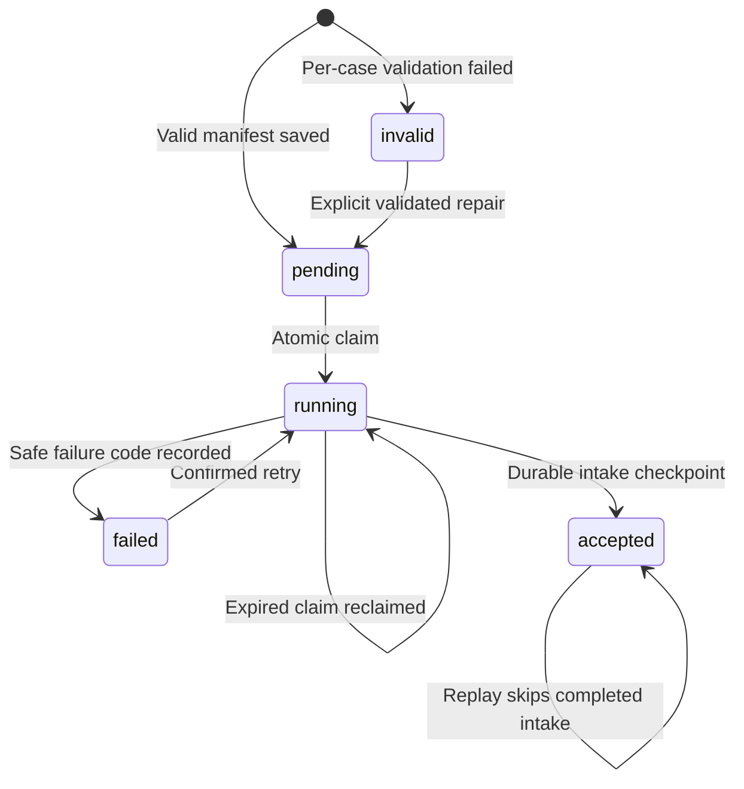

# Build bulk multi-case JSON imports

Open **Build → Bulk JSON imports** at `/build/import-batches`. This is a local/mock
extension of the existing Build integration studio. Go owns validation and durable
intake; the existing Redis/Go/Python pipeline, evidence QA, independent response
permissions and explicit mock-note approval remain unchanged.

## File and validation contract

Upload a JSON object with schema version `1`, optional name, and 1–10 cases:

```json
{
  "schema_version": "1",
  "name": "Local login showcase",
  "cases": [
    {"key": "login-a", "name": "Login A", "document": {
      "schema_version": "1", "events": [], "context": null
    }}
  ]
}
```

The empty events above describe the shape, not valid evidence. **Load two-case
local example** generates a valid file for the signed-in operator's authorized
source. Each case reuses single-case validation: 4–12 login observations or exactly four
linked phishing observations, one finding, unique evidence references and the L1
budget. IAM/MFA/EDR context is optional for login only. Go requires the tenant in the evidence to match authenticated context;
connector identity is derived by Go, never accepted as routing authority.

The manifest is limited to 512 KiB, each case document to 64 KiB and case keys to
64 characters (`A–Z`, `a–z`, numbers, `_`, `-`, `.`; alphanumeric first character).
Duplicate keys, NUL characters (unsupported by PostgreSQL jsonb) and malformed
envelopes reject the batch. Valid envelopes return
per-case validation failures without blocking unrelated cases. Unknown document
fields are invalid; only typed document fields are retained for repair, not
arbitrary unknown fields from invalid JSON. Treat uploads as evidence, not as a
place to supply credentials.

Preview shows normalized observations, context counts and missing evidence. Save
records a durable manifest but does not ingest events. Explicit confirmation of
**Import / retry unfinished cases** includes every displayed case revision and
advances only valid, unfinished cases. A concurrent repair requires refresh and
new confirmation; the atomic claim also checks that exact case revision.

## Identity, recovery and repair

Each batch has a client-retained `batch-<uuid>` ID. Repeating creation with the same
manifest returns its stored progress; changed input under the same ID returns 409.
The creation hash covers the compact JSON request (object field order in raw case
JSON is significant); retain the same request when recovering a lost response.
A later case repair does not change this original creation replay identity.

Each case derives a stable `build-<uuid>` profile ID from tenant, batch and case
key. Replays use that profile and the existing event identities. Importing the same
events under a **new** batch deliberately creates independent cases; this is not
cross-batch deduplication.



Claims last 60 seconds. Per-case database/import work has a 2-second deadline;
processing is sequential with an 8-second work budget and a 12-second request
ceiling below the API write timeout. Cases not reached remain pending for an
explicit retry. Claims prevent concurrent
requests from normally importing the same case; downstream idempotency remains the
final protection if an expired owner races with recovery. Claim-token checks prevent
stale receipt writes. If a process dies after intake commits but before the batch
receipt commits, retry after expiry reuses the sealed profile and records zero new
events. There is no detached HTTP goroutine or new background scheduler: the analyst
explicitly retries unfinished intake; existing workers continue accepted cases.

Repair uses `expected_version`, validates the corrected case and records an audit
entry. It is allowed only for pending/invalid/failed items **before their profile
exists**. Accepted evidence, running items and existing profiles cannot be rewritten
through repair. Lost-response replay of an identical repair is safe. If a profile
already exists, retry its original snapshot; use a deliberately new batch to import
different evidence.

## Progress and retention quotas

Progress separates **accepted intake**, **processed stream observations**,
**investigation/review state** and **synced mock notes**. Accepted is not completed
AI investigation. The synced note is the existing completion checkpoint. Refresh
batch progress after imports, recovery or analyst review; counts are read-time
observations, not a claim of an atomic cross-pipeline snapshot.

Administrator settings (restart the local backend to apply):

| Environment setting | Default | Allowed |
|---|---:|---:|
| `AISOC_BUILD_MAX_RETAINED_PROFILES` | 20 | 1–200 |
| `AISOC_BUILD_MAX_RETAINED_BATCHES` | 20 | 1–200 |

Both are per-tenant retained-record caps, shared across authorized sources. All
single-case saves, clones and batch-created profiles use the same profile cap.
Archived profiles count; neither archive nor completion frees quota. Admission is
serialized on the tenant row to prevent concurrent creation exceeding a cap.
A batch is not a reservation of profile slots: quota exhaustion may admit some
cases and fail others with `LOCAL_RETENTION_QUOTA`. Raising a reviewed limit and
retrying resumes those cases without duplicating accepted cases.

No automatic deletion, TTL, archival payload removal or approval bypass is added.
These caps are not a physical-disk quota: revision history, events, evidence and
audit retention remain separate. Lowering a cap below current usage blocks new
records while preserving existing reads and retries. Read lists are bounded to the
maximum configurable 200 retained records.

## API and implementation

- `GET /api/v1/build/import-batches`: authorized manifests and tenant quota usage.
- `POST .../import-batches/preview`: per-case validation/evidence, no mutation.
- `POST .../import-batches`: save/replay manifest, not intake.
- `GET .../import-batches/{id}`: per-case state, revisions and pipeline progress.
- `POST .../import-batches/{id}/process`: `{ "confirm": true, "expected_versions": { "login-a": 1 } }`; returns 202 with
  the resulting intake checkpoint, including individual errors.
- `PUT .../import-batches/{id}/cases/{key}`: `{ "expected_version": 1,
  "case": { "key": "login-a", "name": "Login A", "document": {} } }`.

Save/preview bodies add `id` and `scope_id` to the file shape. Scope grants are
checked on every operation, including reads and recovery. Foreign-tenant batch
lookups return 404; absent source grants are denied. Responses expose safe error
codes rather than raw database errors. A lost HTTP response can leave work committed:
refresh saved progress before retrying.

Migration **050** adds `local_import_batches` and `local_import_batch_items`.
`localintegrations/batches.go` reuses `Save`, `Seal`, `Preview` and the durable event
intake. Queries remain parameterized sqlc/pgx. No new service or infrastructure is
required. The frontend is `BuildBulkImport.jsx`; existing single-case authoring
remains available and uses the configurable quota too.

Rollback: disable new batch creation/processing and retain the new tables and
profile identities. Accepted cases continue through existing workers. Do not drop
batch receipts, reset item states or delete source events to bypass a failed quota.
Older code cannot resume batch manifests; prefer a forward fix. No breaking schema
change or live response enablement is included.

## Verification scope

Go tests cover per-case validation, concurrent claims, profile/batch quotas,
partial success, repair/replay, immutable accepted cases, tenant isolation and
crash recovery after intake. HTTP acceptance exercises two independent profiles
through explicit mock-note approval and sync, plus foreign reads/writes and retries.
Frontend tests cover import envelopes and honest progress labels. Browser tests use
synthetic local JSON, preview, partial import/repair and responsive layout.

An importable demo file is available at
[`examples/scenarios/suspicious-login/bulk-cases.json`](../examples/scenarios/suspicious-login/bulk-cases.json).
It contains two historical synthetic login cases for tenant `demo`, with no live
credentials or external actions. For a different tenant, use the UI-generated
example so evidence is bound to that authenticated tenant. Select an authorized
local source and validate the file before saving/importing.

## Verified results — 2026-11-01

- Full disposable Detect-to-Build acceptance passed in **193.93 seconds**. Both
  batch cases reached explicit mock-note review and synchronization; replay after
  a simulated post-intake crash inserted **zero** extra events. Tenant-negative,
  stale-confirmation, repair and idempotent creation checks passed.
- Go race tests and vet passed in that full run, including concurrent intake and
  quota integration tests. A final pre-storage NUL-character guard was added after
  that run; targeted localintegrations, HTTP and configuration tests passed again.
- Frontend lint/build and all **14 frontend test files** passed. Vite still reports
  the existing large-bundle warning (main bundle approximately 1,025 KB).
- `scripts/framework/bulk-import-browser.js` passed against local services: file
  upload, valid/invalid case previews, partial import, stale-confirmation denial,
  repair, replay, immutable accepted evidence, refresh persistence and 390px layout;
  no page errors. It uses no operator credentials. Synthetic browser batches and
  their investigations remain in the local database awaiting analyst review.
- The importable `bulk-cases.json` demo file passed Go validation for both cases
  through the real browser file picker. sqlc consistency and whitespace checks passed.

Acceptance caught a draft/awaiting-review status projection mismatch; the query
now uses the same analyst-review mapping as the existing single-case workspace.
Reports: `output/platform-acceptance/report.json` and
`output/backend-framework/bulk-import-flow.json`; screenshots:
`output/playwright/bulk-import-desktop.png` and `bulk-import-mobile.png`.
No live provider, real model quality or production-scale retention was validated.

Completed intake manifests can now be snapshotted through [Build retention](RETENTION_RECOVERY.md). This preserves per-case checkpoints and replay keys; it does not delete batches or release quota slots. Active/failed/invalid batches remain protected.

## Additional local scenario

The shared document validator also accepts exactly four linked credential-phishing observations without IAM/EDR context. Single-profile and bulk JSON imports use the same sealed snapshot and replay controls. Use the phishing example from Build for the authenticated tenant. See [the phishing contract](PHISHING_FLOW.md).
