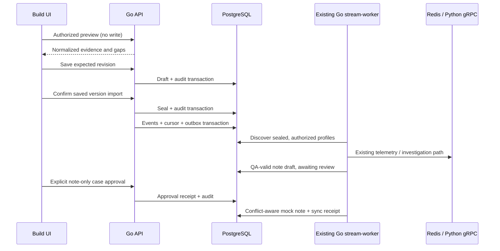

# Build: local integration management

Open **Build → Local integrations** at `http://localhost:8080/build/integrations`.
The React/Chakra workspace manages local JSON fixture profiles through Go. It does
not edit vendor connector credentials, contact external endpoints or certify a live
connection. Existing provider-specific connector records remain inspect-only.

## Operator workflow

1. Choose **New local integration**, give it a name and select an authorized mock
   source. Eligible startup grants allow mock intake, require analyst review and
   forbid sandbox response execution. An operator without a grant sees an explicit
   empty-permission state; the browser cannot create its own grant.
2. Load the local example or import login-event and optional IAM/MFA/EDR JSON files.
   Edit the JSON, user/device references or historical freshness window. The name
   and evidence remain editable while the profile is a draft. Existing scope IDs
   are fixed after first save.
3. **Validate & preview** uses Go normalization and the actual L1 task validator.
   It shows normalized observations, context outcomes/freshness, candidate findings
   and expected evidence gaps. A successful result is a fixture check, not a vendor
   connectivity receipt or model verdict. Preview does not persist or ingest data.
4. **Save draft** validates again and saves an audited, versioned snapshot. Stale
   writes return a conflict and preserve editor text. Client-generated profile IDs
   remain stable across retries, including an uncertain first-save response.
5. Explicitly confirm **Import saved JSON**. Go seals the profile before accepting
   events. Subsequent edits are rejected. A failed or lost import response can be
   retried with the same version; event/case/note idempotency remains in the existing
   pipeline. Create a new profile for different evidence.
6. **Refresh pipeline status**, then **Open investigation**. The existing L1 review
   screen shows evidence, hypotheses and approval. Only explicit note approval can
   let the worker append a mock SOAR note; no containment or case closure is enabled.

The retained showcase is **Build local IAM/EDR showcase**. It generated
[the local demonstration case](http://localhost:8080/investigations/INV-d58a2be3-c4a5-43c7-bbfc-bfea4afba822),
with six evidence references, an INCONCLUSIVE mock result and a clearly labelled
simulated approval. Replaying its import inserted zero events.

## Validation and isolation

Profiles accept schema `1`, exactly four related normalized login observations and
an optional [IAM/MFA and EDR bundle](LOGIN_CONTEXT_ADAPTERS.md). Evidence must yield
one suspicious-login candidate. Unknown request fields are rejected. Login JSON
files are limited to 64 KiB and context files to 32 KiB in the UI; Go independently
bounds the complete normalized document to 64 KiB and validates the typed task.
References must be unique across login and context evidence. Invalid identifiers,
foreign tenants, malformed/future event times, unsupported outcomes, bad bindings
and over-budget tasks fail before saving or sealing.

Tenant identity comes from authenticated Go context. The source stays `qradar-siem`;
each profile derives an isolated connector ID `build-<uuid>`. Input connector IDs
are deliberately rebound to that profile, and preview displays the assigned
identity. A child ID cannot collide with a startup-configured scope or connector.
User/device matching and historical freshness use the existing Go adapters. Neither
an event body nor the editor can grant permissions or supply response authority.

Every profile belongs to one startup grant. Listing, reading, previewing, saving,
importing and approving require that operator's matching tenant/grant. Foreign
profiles are unavailable. If the grant is removed, the profile becomes inaccessible
and processing stops after services load the changed startup configuration.

## Persistence, import and recovery

Additive migration **042** creates `local_integration_profiles`: tenant, ID, parent
scope, name, revision, draft/sealed state, normalized JSON, actor and timestamps.
A tenant can retain at most 20 profiles; the UI lists the complete bounded set.
There is no deletion/archive workflow in this initial local facility. Tenant
initialization, revision checks, profile mutations and their audit writes are atomic.
Queries are generated with sqlc/pgx in `localintegrations/localsql`.

Sealing and event acceptance are deliberately two recoverable transactions:

- Seal records an immutable source document and audit receipt.
- Existing `eventstate.Accept` commits the four events, source cursor and outbox.
- Failure between those steps leaves a sealed, retryable profile; no edit/rebind is
  allowed. Repeating import uses the current checkpoint and stable event identities.
- A concurrent checkpoint conflict is visible and can be retried. It never silently
  changes the payload or starts another case under a fresh source identity.

The existing Go stream-worker discovers sealed profiles beneath eligible startup
grants. It schedules ten oldest-touched profiles per pass, with a five-second
per-profile budget, reusing publication, consumer ACK/reclaim, durable retry,
reconciliation, correlation, admission, Python dispatch and SOAR sync primitives.
Profiles awaiting human review or already synced release this processing capacity;
recording approval makes pending synchronization eligible again. No second agent
orchestrator, datastore, event bus or worker service is added.

## API

All paths are below `/api/v1/build/integrations` and use normal tenant/session/CSRF
middleware. JSON writes reject unknown fields; the existing request-size cap also
applies. Profiles and previews return `Cache-Control: no-store`.

| Method/path | Contract |
|---|---|
| GET `/` | Authorized profiles and eligible startup scopes, maximum 20 profiles per tenant |
| GET `/example?scope_id=…` | Bounded synthetic login document and configured optional context; no external call |
| POST `/preview` | `{scope_id,id,document}` → normalized events, candidate finding, context and gaps |
| PUT `/{id}` | `{scope_id,name,expected_version,document}`; version 0 creates, positive version edits a draft |
| GET `/{id}` | Authorized profile, worker checkpoint status and generated cases |
| POST `/{id}/import` | `{expected_version,confirm:true}` → sealed state and existing event acceptance receipt |

Case `/l1` exposes the authorized child profile ID as `review_scope`. The existing
`POST /api/v1/stream-operations/{scope}/approve-mock-note` resolves that child through
its parent grant. Child scopes do not inherit source import, retry/rebase or sandbox
response permissions. The Build import endpoint is the only profile intake path.

Typical errors: 400 invalid JSON/evidence/confirmation; 403 missing grant; 404
missing/foreign profile; 409 stale revision, sealed edit, quota or changed checkpoint.
Names and evidence render as text. No uploaded JavaScript, HTML, command or URL is
executed. Editors preserve text on validation and write errors.

## Deployment, rollback and limits

Run the existing foundation startup to apply migration 042 and deploy Go API/worker
and frontend together. Existing static scopes, CLI scenarios and provider connector
records retain their behavior. Profiles created through the UI need no worker restart.
No grants or credential files are rewritten by the API.

Rollback pauses managed profile processing and retains profiles, events, jobs,
notes and audit records. Older binaries ignore the new profile table; they cannot
process the new sources. Restore the matching binaries to resume. Do not drop the
table or delete receipts to replay evidence. Include the table in normal PostgreSQL
backup/restore. The preserved release profile is not migrated by this work.

Limits: local historical fixtures only; four login events and one finding per
profile; manual status refresh; no profile deletion/archive, scheduled live polling,
provider configuration editor, production throughput claim or response activation.
Generalize these only with separately tested contracts and operational requirements.
See [testing evidence](TESTING.md) and [Build catalog](BUILD_WORKSPACE.md).
