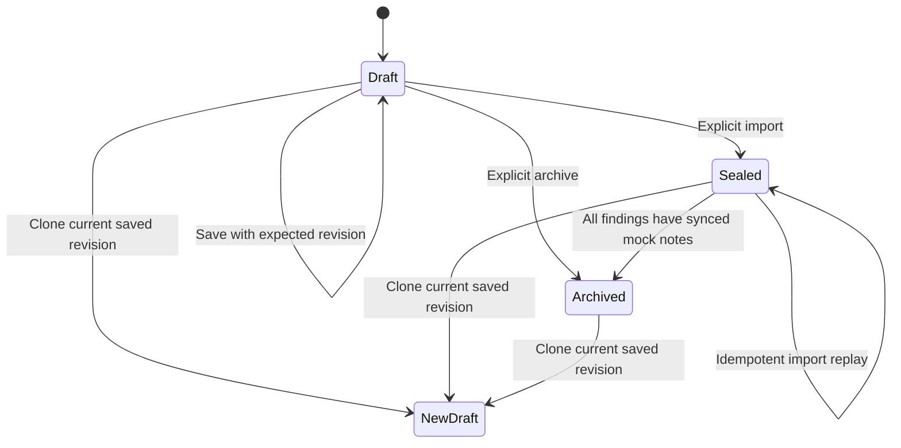

# Build integration lifecycle (local/mock)

This extends the existing Build studio; it does not add live connector execution.
Open `/build/integrations` through the frontend on port 8080.

## Lifecycle and ownership



Go authorizes every operation against the authenticated tenant/operator and stored
startup grant. An archived profile remains visible and its cases, source events,
notes and audit records remain intact. Import, replay and editing are denied after
archive. No restore-in-place is provided: reuse requires an explicitly imported
new draft. Archiving is organizational, not cancellation or response authorization.

A sealed profile cannot be archived while intake, inference, analyst review or
mock note synchronization is incomplete. Retry import or finish the existing
review first. This prevents hiding unfinished durable work. Sealing holds the
same profile row lock used by archive; once sealed, archive requires completed
write-back. An already-completed worker pass may finish its heartbeat after
archive, but archived profiles are never selected for new managed passes.

## Safe cloning and versioning

`POST /api/v1/build/integrations/{id}/clone` takes `expected_version`, a new stable
`build-<uuid>` ID and `name`. The server copies the saved document, inherits its
authorized scope and rebinds each event to the new connector. It never clones
import receipts, cases, approvals or response actions. The result is revision 1
in draft state, with `cloned_from` and `cloned_version` lineage. Importing that
new connector intentionally creates independent evidence/case identities, so the
operator must review before confirming import.

Reusing the same clone ID/source revision/name is retry-safe, including after a
lost response. Changing those inputs for an existing ID returns conflict. Source
revision changes reject a new clone. The UI retains its request ID during retries.
Unsaved editor changes must be saved before cloning or archiving.

Draft saves use optimistic revision checks; archive increments the revision and
requires explicit confirmation. A repeated archive by the same actor with the
original or resulting revision returns the existing archived profile. Clone,
archive, revision snapshots and audit writes commit atomically.

Migration **047** adds lineage and archived state to profiles and creates
`local_integration_revisions`. A database trigger retains each configuration
revision within the mutation transaction. Sealing preserves the same revision;
history records the state when that snapshot was first saved, while current state
and audit record the seal. Existing profiles backfill only their current snapshot;
older revisions are not fabricated. Detail returns metadata for the latest 50
snapshots; older snapshots remain stored. The retained-profile limit defaults to 20 and is configurable (1–200); it
includes archived profiles. Archive does not free quota. See [bulk import quotas](BUILD_BULK_IMPORT.md).

## JSON imports and evidence

The file picker accepts an event array or a complete bundle:

```json
{"schema_version":"1","events":[],"context":{}}
```

The empty example describes the shape, not valid evidence. Use **Load local
example** for a valid fixture. A bundle replaces events and context together;
omitted/null context clears prior context. An event-array upload preserves the
separate context editor. Unknown bundle fields and unsupported versions fail.

Go accepts 4–12 normalized observations for one principal, device and canonical
source IP, within the selected five-minute login window and yielding exactly one
suspicious-login finding. Multiple findings, mixed identities, duplicate IDs,
foreign tenants, invalid timestamps, reference collisions and oversized tasks
are rejected. Complete documents remain bounded to 64 KiB; combined evidence
must fit the existing 16-item/16-KiB L1 task budget. Context files retain their
32-KiB UI limit. Raw vendor payload translation remains outside this editor's contract. Multi-case
JSON is handled by the separate [bulk import workspace](BUILD_BULK_IMPORT.md).

All accepted observations enter the existing durable intake. The unchanged
correlator selects the final three failures plus success as the finding's four
evidence references. The UI distinguishes observation count from selected finding
evidence. This does not increase AI workload to one task per raw event.

## Processing and replay visibility

Profile detail includes `intake.accepted_events`, `intake.processed_events`, worker
heartbeat/error state, case/note state, revision metadata and clone lineage.
Accepted counts are retained `stream_events` rows; processed counts are consumer
inbox receipts for `build-login-v1`. They are not AI completion counters. A synced
mock note establishes the completed checkpoint; a healthy heartbeat alone does
not. Stale heartbeat is informational once the checkpoint is reached because
completed managed profiles stop polling.

The import response includes `replayed` and `accepted.Inserted`. A zero-insert
replay preserves existing results; it does not rerun inference or reset approval.
The UI reports each response and refreshes durable pipeline status. A sealed
profile with zero accepted events explicitly prompts import retry. Response
receipts in the browser are transient; durable event/case receipts remain the
source of truth after refresh.

## Validation and rollback

- Go integration tests cover CAS, tenant boundaries, clone retries, archived
  mutation denial, unfinished archive rejection and audit-failure rollback.
- The disposable Detect-to-Build suite imports an extended five-event window,
  verifies the actual worker/QA/review/mock note flow, checks counts, clones and
  archives, validates revision history and denies foreign lifecycle operations.
- Frontend unit tests cover array/bundle parsing and honest processing labels.
- Browser checks cover upload, preview, clone, archive, refresh, immutability,
  retry failures and responsive layout using local APIs or explicit fault mocks.

Rollback by restoring prior code only before archived profiles exist. Older Go
versions do not recognize the archive lifecycle and must not run against archived
records. Prefer a forward fix; retain revision and audit tables and never rewrite
archived profiles to draft automatically. No production response or infrastructure
change is part of this migration.

Managed Build correlation waits for the entire sealed document to be accepted and
recorded in the consumer inbox before calling `AdvanceMock`. This prevents partial
stream delivery from selecting a different last-three-failures finding. Archive
also requires that complete-snapshot checkpoint for sealed profiles.

## Verified local results — 2026-11-01

The final disposable Detect-to-Build acceptance run passed in 230.06 seconds:
five observations accepted and processed, one verified investigation, explicit
simulated note approval, one mock note and zero additional events on replay.
Clone retry, archive guards, revision history and tenant-isolation checks passed.
Go race/HTTP tests, audit rollback and partial-inbox snapshot checks passed.
All 10 frontend test files, lint, build, sqlc consistency and Go vet passed.

Real browser checks passed for bundle upload, five-event preview, clone/save/archive,
three retained revisions, refresh persistence, desktop/mobile layout and zero page
errors. A real replay of the existing showcase retained its mock note and inserted
zero events. Fault-intercepted browser tests also passed for stale saves and lost
import responses. Local archived browser-test clones were retained intentionally.

One early full-suite attempt failed the Python mTLS immediate readiness assertion;
subsequent complete runs passed, including the final run. No production model or
vendor was exercised. Vite still reports the existing large frontend bundle warning.
Reports and screenshots are under ignored `output/platform-acceptance`,
`output/backend-framework` and `output/playwright/build-lifecycle-*.png`.
