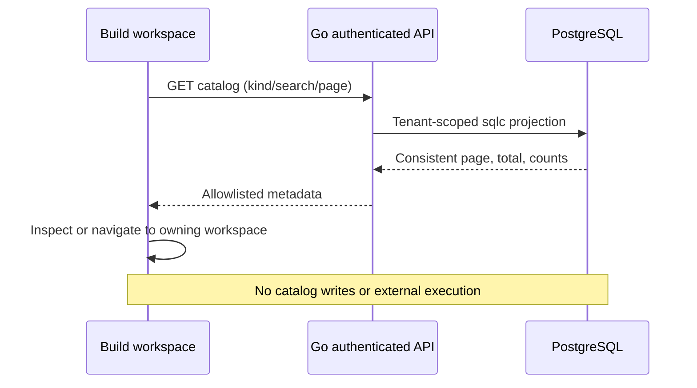

# Build workspace

## Reference and scope

Reviewed [7AI Platform](https://7ai.com/platform), [Skills](https://7ai.com/platform/skills) and [Response](https://7ai.com/platform/response) on 2026-11-01. The public “Build on 7AI” link leads to Skills. No standalone Build screenshot was verified. Existing Skills library/editor and Response canvas patterns informed this AISOC extension; it is not an exact replica of an unseen vendor screen.

`/build` is the first Build submenu. Toolkit cards link to skill templates, workflow design and API source configuration. The catalog unifies saved Skills, workflows, runbooks, API sources and connector metadata, with filters, literal search, pagination and an inspector. Legacy routes are preserved.

Skill actions open the selected editor. Workflow/runbook/source actions open their owning list manager. Connector rows are inspect-only because the Cribl screen is a creation wizard. Browsing performs no provider requests, policy changes, model activation or response execution.

## API and persistence

Authenticated `GET /api/v1/build/catalog` accepts:

| Parameter | Contract |
| --- | --- |
| kind | all (default), skill, workflow, runbook, api_source, connector |
| search | Literal case-insensitive name/description substring; trimmed; maximum 200 characters; NUL rejected |
| limit | 1–100, default 25 |
| offset | 0–1,000,000, default 0 |

Unknown/repeated parameters or invalid values return 400. Tenant comes from authenticated context. Response contains items, filtered total, global tenant counts by kind, limit and offset. Each item contains id, kind, name, description, stored state, updated_at and allowlisted details. A single SQL statement provides consistent counts/page, sorted by lowercased name, kind and ID. Out-of-range pages preserve total.

The Go module internal/modules/build uses sqlc/pgx over skills, response_plans, response_workflow_policies, api_sources, detection_rules and connectors. No migration or duplicate storage; schema remains 040.

Source state precedence is revoked → expired → no_key → key_valid. Key validity indicates stored key presence/expiry, not provider connectivity. Connector state/test date are saved metadata. Policy status describes existing local preview configuration. Skill instructions, workflow bodies, key hashes, mapping contents, connector config, client IDs and credentials are excluded. Names/descriptions remain user-authored tenant-visible metadata.

## Flow

## Validation and limits

- Isolated PostgreSQL tests cover isolation, pagination, empty out-of-range totals, literal wildcard search, all asset kinds, source-state precedence and credential/body omission.
- HTTP tests reject invalid/unknown/repeated filters before database access.
- scripts/framework/build-workspace-browser-check.js tests pagination, inspector, read-only connectors, search, stale responses, desktop/mobile, error/retry and manager navigation using intercepted read-only fixtures.
- Navigation tests preserve legacy Build routes. Run frontend lint/build/tests, full Go race suite, sqlc drift and vet.
- No throughput claim: this interactive catalog is not a telemetry path. Large asset counts may require indexed catalog/search projections instead of offset pagination and per-request counts.
- Pending: provider-specific existing-record connector editors, separately specified advanced builder features, and production-scale catalog benchmarks.

Rollback: revert the additive module, route and UI, regenerate sqlc and rebuild. No database rollback required.

## Verified local result (2026-11-01)

PostgreSQL integration tests, full Go race suite, sqlc drift, focused vet, frontend lint/build and 9 frontend test files passed. Browser fixture checks passed at 1440px and 390px; live API returned 200 with 10 existing demo assets and all 10 rendered. No test data was added to the demo database. Independent review corrected connector navigation to inspect-only. The existing Vite large-bundle warning remains.

## Platform review (2026-11-01)

API-source manager now pages sources and searches/pages detection-rule choices. The Cribl creation wizard stores configuration and explicitly states live validation is unsupported; saving returns to Build and clears the secret from the form. See [review and verification](PLATFORM_REVIEW_2026-11-01.md).

## Build local integration management (042)

[The local integration studio](BUILD_INTEGRATIONS.md) at `/build/integrations` adds versioned
draft editors, JSON file import, Go validation and evidence preview. Explicit import
seals a tenant-scoped snapshot and feeds the existing workers without restart.
Case note approval remains mandatory; provider endpoints and response execution
remain disabled. Existing provider-specific connector records remain inspect-only.
