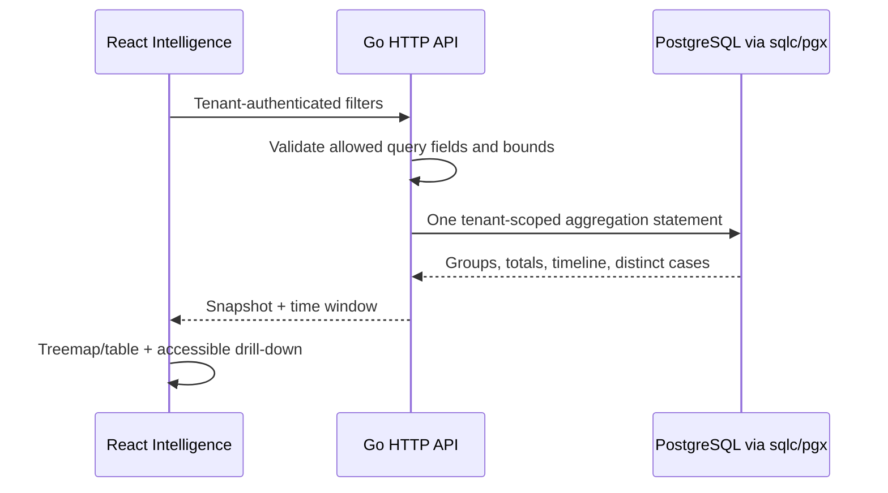

# Detection Intelligence

Implemented 2026-10-31 using the first product screenshot on [7AI Detection](https://7ai.com/platform/detection) as a layout reference. AISOC keeps its own navigation, authentication, tenant boundaries and data. Screenshot counts and vendor logos are not fabricated as connected sources.

## Open and use

Open `/detect/intelligence` on the frontend (local development: http://localhost:8080/detect/intelligence). The pictured `/detect/detection-intelligence` path is also supported as an alias; existing links remain canonical.

The page contains a searchable source inventory, provider/rule treemap, Investigation Coverage and Escalation tabs, expandable accessible table, linked-case drill-down, category/severity breakdowns and daily stacked alert volume. Selecting a source or tile filters the server projection. Clear filters resets search, source, severity and rule. View in Investigations expands a list of up to 50 **distinct** linked cases matching those filters; Open investigation navigates to the real case. It does not navigate to an unfiltered queue.

Use 7/30/90-day rolling windows. The timeline includes both partial boundary UTC dates. Daily average divides the full matching count by the requested number of 24-hour days. Refresh and Retry reload the projection; stale data is removed on filter changes or failures. Requests are cancelled when superseded or when leaving the page.

## Metric definitions and deliberate differences

- **Investigation Coverage:** linked alerts / received alerts per source/rule group. Full = 100%, Majority = 50%–<100%, Partial = >0%–<50%, None = 0%. Linking is not evidence of investigation completion or detection effectiveness. The reference's Enriched state is omitted because the current alert projection does not establish enrichment completeness.
- **Escalation:** count of alerts whose recorded routing is `Escalate`. This is a routing decision, not proof of executed containment or analyst acceptance. A group is highlighted when at least one alert was escalated; its exact count remains visible.
- **Categories:** rule `category` metadata; absent/empty values are Unclassified. No category inference from provider names. Category editing/enrichment is outside this change.
- **Severity:** recorded alert severity. The daily plot uses severity rather than the reference's source-color series and exposes exact daily totals in an expandable table.
- **Cases:** distinct tenant-owned investigations, with matching alert counts and current determinations. Missing/foreign case references do not count as coverage.
- **Source badges:** not invented. The existing data does not supply reliable product icons or source capability tags.

The treemap returns the largest 200 source/rule groups; a visible notice reports truncation and full group count. Summary totals cover all matches. Small provider columns retain a minimum interactive width and scroll within the map, so cross-provider areas are approximate when this minimum applies. The table provides exact counts and ratios independently of tile geometry. Cases are capped at 50 and the caption states the limit; this is not a complete case export.

## Backend and contracts

`GET /api/v1/detection-intelligence` accepts optional `days` (1–90, default 7), `source` (up to 200 characters), `severity` (low/medium/high/critical), `search` (up to 200 characters), and `rule_id` (up to 256 characters). Unknown or repeated parameters are rejected. Search is a literal case-insensitive substring across alert title, rule name and source/provider; SQL wildcards and query fragments are not executed.

The existing fields remain compatible. New fields: `as_of`, `window_start`, `groups`, `group_count`, `by_category`, `investigations`, and `totals.linked_alerts`/`escalated_alerts`. Groups contain `source`, `rule_id`, `rule_name`, `count`, `linked`, `escalated`. Investigations contain `id`, `alert_title` (one example matching alert), `determination`, `alerts`, `last_alert_at`.

The sqlc query is `backend-go/internal/modules/detection/queries/intelligence.sql`; generated pgx bindings live in `detectionsql`. One parameterized statement uses one MVCC snapshot and one time cutoff. Tenant predicates apply to alerts and every join. Future timestamps are excluded. Missing rule names fall back to canonical rule IDs. No schema migration, new service or dependency is required.

## Validation and operations

- `python3 scripts/framework/check_detection_intelligence.py`: disposable PostgreSQL, race-enabled detection and HTTP tests; never changes demo data.
- `node --test tests/frontend/*.test.mjs`: treemap area/overlap invariants, coverage boundaries, UTC boundary dates, existing frontend tests.
- `make -C backend-go sqlc-check`, frontend lint/build and Go vet.
- `scripts/framework/detection-intelligence-browser-check.js`: local read-only browser flow, query rejection, tenant isolation, tile/case navigation, empty search, 90-day responsive chart, failure/retry.

No throughput improvement is claimed. This dashboard reads received alerts (including imported demo alerts); it is not a count of all buffered telemetry. Very large tenant histories may require measured indexing or a rollup projection later. Rollback consists of restoring the prior frontend and Go binaries; no data rollback is needed.

### Verification result (2026-10-31)

Passed: disposable PostgreSQL detection suite with the race detector, HTTP query-validation tests, six frontend test files, sqlc generated-code diff, Go vet, ESLint and the production build. The read-only browser suite passed on development and compiled preview builds at 1440/768/375px, including 90-day chart bounds, source/rule and case navigation, tenant isolation, empty results, and error/retry. Existing build output still warns about large JavaScript chunks; this change does not resolve application-wide code splitting.
