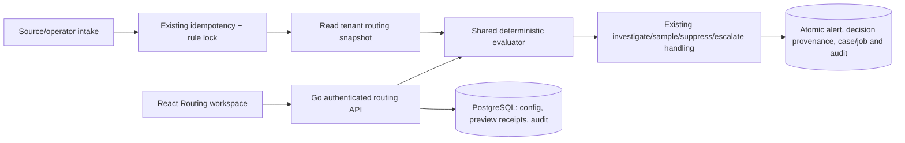

# Detection Routing

Implemented 2026-11-01 from the reviewed [Detection Routing screenshot](https://47518862.fs1.hubspotusercontent-na1.net/hubfs/47518862/05-routing-browser.png). Open `http://localhost:8080/detect/routing`; `/detect/detection-routing` is an alias. Detect → Routing and breadcrumbs use the existing navigation model.

## Workspace

The Universal Rule Routing table preserves the screenshot's hierarchy, status, name, exceptions, outcome, impacted-rule and editor columns. Search/status filters, ordering arrows, draft/edit/archive actions and pagination operate on a bounded tenant configuration. The other tabs expose Per-Rule Routing, Audit Logs and Entity Lists. AISOC branding and existing React/Chakra styles remain.

Policies start as drafts. Editor changes are staged locally; Save configuration requires explicit confirmation. Reload after a conflict asks before discarding staged edits. Table editor/time values describe the last saved **configuration**, not invented per-policy authors. Impact counts appear only after Preview routing and refer to that replay sample. They reset after configuration edits or saves. No screenshot example policies/counts are inserted into the demo database.

Entity lists contain at most 500 unique case-sensitive literal values. They can scope matching or exempt entities. No regex, CIDR expansion, external list fetching or privileged action is performed. Referenced lists cannot be removed through the UI; the backend rejects dangling references. Limits: 100 policies, 50 lists and the existing 1 MiB HTTP body cap.

## Evaluation and activation

- Enabled policies are evaluated in configured order; the first match wins. Draft/archived policies are skipped. Array order is authoritative hierarchy.
- Nonempty source, severity, rule ID and entity-list conditions are ANDed. An exception-list match skips that policy and continues evaluation. Empty conditions match any value.
- No match uses the existing per-rule route. Existing **Escalate** defaults are protected against universal overrides; disabled detection rules continue rejecting intake. Unknown legacy default routes safely investigate.
- Outcomes are Investigate, Sample (10%), Suppress and Escalate. Suppress retains the alert without creating an investigation. Sampling uses the existing deterministic tenant/source/external-ID hash; preview explains route eligibility, not the exact sampled selection. Escalate creates analyst-review work through the existing intake path.
- Changes affecting active configuration require a server-stored preview receipt under 15 minutes old, matching the exact proposed configuration and current revision. The backend rereads the frozen sample and checks its hash. A nonempty sample is required. Editing only drafts does not require preview when the active configuration is unchanged. Disabling all policies is always available without a receipt.
- Preview covers the latest **up to 500** stored alerts at its cutoff, with current detection-rule defaults/enabled state. Counts show first-match effective policies, not every potentially matching policy. Older alerts and later arrivals are outside the scope; preview does not guarantee future detection quality or measure a complete historical population.
- There is no retrospective rerouting. Duplicate intake returns its original stored alert/decision even if routing configuration has changed. Stream findings retain their mandatory protected Escalate behavior.

Set a staged policy to enabled **before** previewing it; drafts do not participate. Review the per-event “why this route?” explanation, close the preview, then save. Expired receipts, changed configuration/rule routing/evidence or concurrent saves require a new preview/reload as appropriate. A new event after the frozen cutoff does not invalidate the receipt.

Quarantine, enrichment workflows and external synchronization shown in the vendor image are not offered as routing outcomes. They require separate provider/action authorization and remain outside this local routing feature.

## Architecture and contracts

`backend-go/internal/modules/routing/engine.go` defines typed policy/list/event/decision contracts. `store.go` owns configuration, preview receipts and audit. `queries/routing.sql` generates `routingsql` through pinned sqlc; pgx binds parameters. `intake/alerts.go` calls the evaluator inside its existing transaction after deduplication and the enabled-rule check. Alert JSON includes `routing_decision` with outcome, policy ID, configuration version and explanation. A routing read error aborts intake rather than silently bypassing policy.

Migration `035_detection_routing.sql` adds `detection_routing_configs` and `detection_routing_previews`. Configuration writes lock the owned tenant row and enforce optimistic revision. Audit and configuration commit atomically. Audit stores before/after snapshots, actor and revision; its list API omits full snapshots to bound response size. Preview receipts older than 24 hours are pruned on subsequent previews (not a background expiry daemon); only receipts under 15 minutes authorize activation.

| API | Contract |
|---|---|
| GET `/api/v1/detection-routing` | Tenant `config: {policies, lists}`, `version`, `updated_by`, `updated_at`; missing configuration is empty version 0 |
| POST `/api/v1/detection-routing/preview` | `{config, expected_version}`; returns receipt ID, sample count/cutoff/limit, per-policy impacts and event explanations |
| PUT `/api/v1/detection-routing` | `{config, expected_version, preview_id}`; validated CAS save, returns saved state; 409 for stale/missing activation receipt or revision |
| GET `/api/v1/detection-routing/audit` | Latest 100 tenant universal-routing audit summaries |
| Existing rule PATCH | Per-Rule tab uses `{routing, expected_version}`; existing rule history/version/audit retained |

Unknown fields/query parameters are rejected. Actor and tenant come from existing auth middleware, never policy payloads. IDs are bounded allowlisted identifiers; matching values are literals. Rule IDs in conditions refer only to events within the authenticated tenant and do not fetch other tenants' data.

## Verification

Run `python3 scripts/framework/check_detection_intelligence.py` for disposable PostgreSQL race tests across detection, routing, intake and HTTP. Routing tests cover precedence, exceptions, protected escalation, disabled rules, unsupported containment outcomes, explicit array/list validation, tenant isolation, receipt expiry/sample changes, empty-sample activation rejection, CAS races, audit rollback, actual intake suppression/exceptions and original-decision duplicate replay. Existing stream-finding, source credential and worker intake regressions run in the same suite.

Run `npm --prefix frontend run lint`, `npm --prefix frontend run build`, `node --test tests/frontend/*.test.mjs`, `make -C backend-go sqlc-check`, and Go vet for changed packages. `scripts/framework/detection-routing-browser-check.js` uses real read-only API checks and intercepted mutations for draft/list editing, confirmation, preview/activation, archive, conflict preservation, slow-save guards, audit, real per-rule defaults and 1440/768/375px layouts. Test both local development and compiled preview builds. Browser fixtures never activate demo policies.

## Rollback and operational limits

Archive all universal policies and save to return to existing per-rule defaults. This needs no activation preview. Restore earlier configuration from audited snapshots through a new CAS save and preview if re-enabling policies. Keep migration tables and audit on application rollback; previous binaries ignore the additive routing tables. Existing alerts/cases remain untouched.

This is local intake policy, not production rollout approval. No capacity/latency claim is made: intake adds one tenant config read and a bounded policy evaluation per fresh alert. Benchmark before high-volume deployment; any future cache must preserve version/invalidation semantics. Long-term audit/preview retention and external policy deployment remain operations work. The existing frontend bundle-size warning remains.

### Verified result (2026-11-01)

Passed: disposable PostgreSQL detection/routing/intake/HTTP suites with race detection (including both deterministic sampling branches and existing stream-finding regressions), eight frontend test files, ESLint, production build, sqlc diff and Go vet. Routing browser checks passed on development and compiled preview; the compiled Rules regression suite also passed. Visual inspection covered populated fixture and empty states. Independent review found a save/reload draft-loss window: editing now stops during writes, reload displays a loading state, and the redundant post-save GET was removed. Local migration 035 is applied; no demo policies or provider actions were activated.
