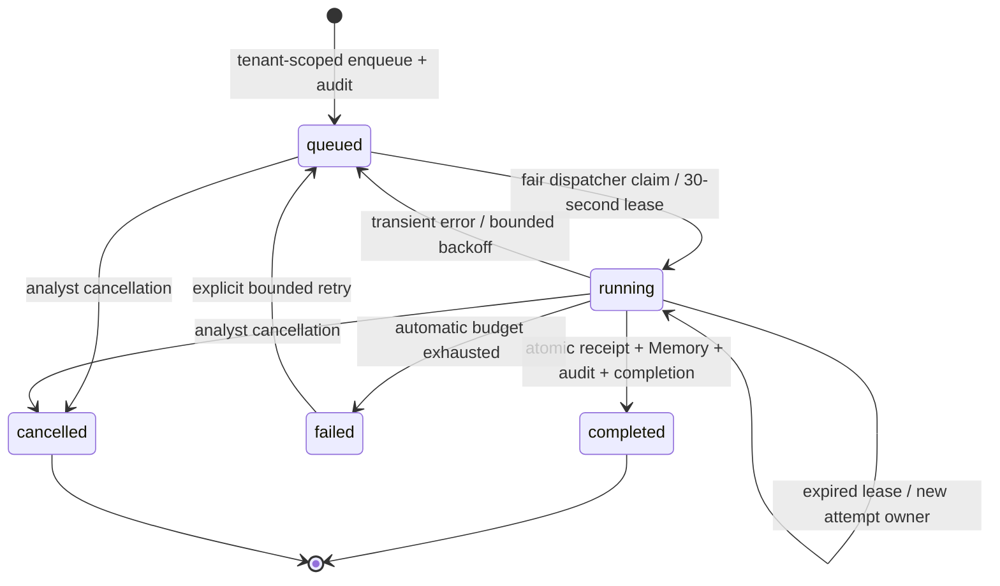

# Durable local Hunt execution

## Scope and operator flow

Hunt's **Run local search** now queues work in PostgreSQL. The existing Go investigation-worker hosts a bounded local Hunt dispatcher alongside case processing; no new deployable, queue service, provider or model is required. Open any hunt at `/hunt/threat-hunting/{id}` to see execution state, persisted phase, attempt budget, requesting operator and frozen hunt revision. Queued/running work exposes cancellation. Failed work exposes explicit retry while budget remains. Completed runs retain the existing evidence, Memory and promotion interfaces.

The query remains a case-insensitive literal phrase of 2–200 characters over the latest 500 tenant cases and 500 artifacts, with at most 100 matches. It does not execute SIEM SQL or call a live source. No match remains inconclusive. The query, actor and hunt revision freeze when queued; evidence is read when an attempt executes. Editing the hunt does not modify an already queued request. Approved Memory is evaluated and snapshotted on successful publication. Retries can see newly stored evidence, but completed receipts are immutable.

## Lifecycle and durability

The shared jobs store supplies tenant-fair admission, persisted attempt IDs, leases and automatic retries. Each attempt uses a 10-second deadline for the local read and a separate 10-second deadline for publication. The database's statement timeout also bounds queries. Restarted workers reclaim expired leases without browser participation. Graceful shutdown cancels execution contexts; abrupt shutdown leaves leases to recover.

Progress phases are `queued`, `searching_evidence`, `recording_snapshot` and the terminal job state. They describe observed work, not estimated percentages. Cancellation fences publication immediately once its transaction commits; an already running read may finish or time out, but cannot publish a receipt afterward. If completion wins the race, cancellation returns a conflict and the completed receipt remains available.

Completion locks the hunt and job, checks the attempt ID and live lease, then stores the receipt, approved Memory snapshots, audit and job completion in one transaction. An audit failure rolls back all those effects. A stale worker cannot complete after another worker reclaims the lease. The jobs output contains only a receipt reference; full evidence remains in `hunt_search_runs`, avoiding the shared jobs output-size limit.

## Limits and controls

- One outstanding queued/running execution per hunt; 100 outstanding Hunt jobs per tenant.
- 100 retained run IDs per hunt across synchronous and queued searches. Completed IDs count once. This is a bounded local retention policy; cleanup/expiry is not automatic.
- Three automatic attempts with existing attempt-based backoff. Explicit retry adds three attempts, at most twice, preserving the run/job ID and prior attempt count. Nine total attempts is the hard limit.
- Retry carries the observed exhausted attempt count. Lost-response replay cannot replenish the budget twice. Cancelled runs are terminal; use a new request ID for an intentional new search.
- Active Hunt deletion is rejected. Finish or cancel before deleting. Hunt deletion retains terminal job metadata but removes the hunt-owned execution mapping and receipts according to existing cascade behavior.
- Tenant and actor come from the authenticated session. Queue/control operations use the existing proposer permission; they grant no response or approval authority.

## APIs and compatibility

| Endpoint | Behavior |
|---|---|
| `POST /api/v1/hunts/{id}/executions` | `{id, expected_updated_at}` → 202, immutable request identity and persisted execution state; same actor/request/revision replays the same job |
| `GET /api/v1/hunts/{id}/workspace` | Existing receipts/notes/Memory/promotions plus up to 100 execution records |
| `POST /api/v1/hunts/{id}/executions/{run}/control` | `{operation: "cancel", attempts: 0}` or `{operation: "retry", attempts: 3 or 6}`; tenant-scoped and audited |
| `POST /api/v1/hunts/{id}/search` | Existing synchronous compatibility path remains available; cannot reuse a pending/cancelled queued run ID |
| `POST /api/v1/hunts/{id}/promote` | Existing explicit reviewed-finding promotion; requires a stored completed receipt |

Promotion remains unique by tenant, hunt, run, finding kind and record ID. Concurrent requests and retries return the same investigation. A deleted promoted investigation is not silently recreated. An intentional new run is a distinct evidence snapshot and may be separately promoted; there is no claim of deduplication across unrelated hunts or newly requested runs.

## Code and deployment

- Migration `053_hunt_execution.sql`: additive execution mapping; expands the existing job plugin allowlist with `go.hunt_search`.
- `backend-go/internal/modules/hunts/queries/execution.sql`: sqlc queue mapping, quota, phase and retry queries.
- `execution.go`: enqueue/control validation, capacity, replay and audit.
- `execution_worker.go`: bounded local read and transactional fenced receipt publication.
- `backend-go/cmd/investigation-worker/main.go`: existing service owns the Go Hunt dispatcher; configured tenant concurrency limit is reused.
- `frontend/src/HuntWorkspace.jsx`: queue submission, non-overlapping polling, progress, cancellation/retry and saved results.

Run the normal migration and refresh the Go API and investigation-worker together. Existing synchronous clients and completed receipts require no conversion. Rollback: stop new queue submissions, drain or cancel outstanding Hunt work, revert API/UI/worker binaries together, and retain migration 053 and historical data. Do not remove the expanded job constraint while Hunt job records exist.

## Verification

`execution_integration_test.go` covers enqueue replay, tenant boundaries, active capacity, reserved run IDs, deletion guard, expired-lease recovery with a new worker, stale completion, audit rollback, queued/running cancellation, retry exhaustion/extensions and concurrent promotion replay. HTTP tests reject malformed queued requests. The disposable API acceptance stage injects an abandoned lease and verifies real worker recovery, cancellation and promotion replay. Browser coverage verifies persisted progress, explicit retry, queue replay and cancellation surviving reload on mobile. Existing Memory-to-Hunt browser checks now run through queued execution.

The full gate is `python3 scripts/framework/release_gate.py --chromium-executable /opt/google/chrome/chrome`. Its API/browser fault fixtures are disposable and must not be run against the active demo. Successful runs are recorded below after execution; these checks do not certify live queries, distributed capacity or model reasoning.

## Verified local release — 2026-11-02

Run `aa47ada7f2d348bdae4a7d64bdea2ed0` passed all five release stages in **450.04 seconds**. Evidence includes six API workflow stages, twelve browser stages, 72 desktop/mobile route checks, frontend lint/build and 35 regression tests, Go race/vet and Python/Rust checks, mock OIDC checks and backup/restore. Durable Hunt browser assertions cover explicit retry, persisted cancellation, enqueue replay and a lost accepted response followed by completed receipt recovery without duplicate runs. Completed and cancelled mobile screenshots were visually inspected.

The initial API attempt exposed a test request missing the required cancellation `attempts` field; that request and documentation were corrected. The subsequent browser run caught overflow from a full run ID in the button label; controls now show short labels with exact accessible names. Earlier failed/superseded runs remain failed. Independent review also identified and resolved a tenant-lock/audit deadlock risk and missing receipt refresh after terminal enqueue replay.

Reports and screenshots: `output/release-gate/aa47ada7f2d348bdae4a7d64bdea2ed0/`. This is local/mock correctness and recovery evidence, not live-provider, distributed-scale or throughput certification.
