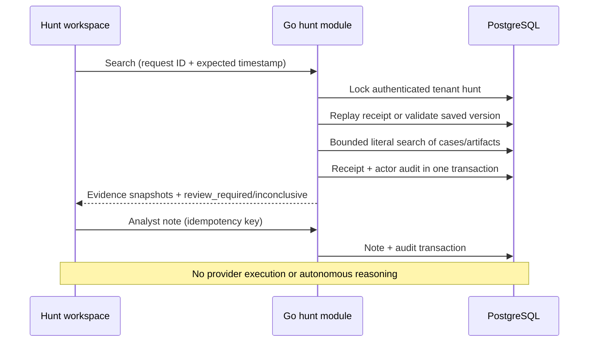

# Hunt workspace

The [Threat Intel → Hunt → Investigate extension](INTEL_HUNT_INVESTIGATE.md) adds JSON import, IOC validation/deduplication, saved-finding promotion and retained source provenance (2026-11-01, migration 044). Existing local workspace behavior below remains available.

Implemented locally on 2026-11-01 after reviewing all four screenshots on [7AI Threat Hunting](https://7ai.com/platform/threat-hunting). This adapts their visible structure to AISOC's stored evidence; it does not claim the vendor's private reasoning engine or live source integrations.

## Screenshot mapping

| Image | Screenshot browser URL | AISOC behavior |
|---|---|---|
| `hunt-threat-hunting-browser.png` | `/hunt/threat-hunting` | Searchable, paginated hunt registry; create and open hunt |
| `hunt-threat-intel-browser-2.png` | `/hunt/threat-intelligence` | Shared TI registry with filtered totals, analyst metadata, report ingestion and report-owned IOC-to-hunt links (migration 039) |
| `hunt-detail-entities-browser.png` | `/hunt/threat-hunting/cve-2026-42897` | `/hunt/threat-hunting/{actual-id}`: Plan, conversation/notes and Entities panels |
| `hunt-detail-findings-browser.png` | Same detail URL | Findings with source record IDs, excerpts and links to the original case; Step details and run-history selection |

`/hunt` remains an alias for the registry. Detail breadcrumbs use a tenant-scoped Go `hunts` label lookup. The screenshot's CVE slug is not seeded as a fake record. Existing `/threat-intel` report detail remains available. The old Hunt dashboard's fallback hunts, invented quotas/counts and decorative lifecycle chart were removed.

The hunt registry shows real creation/update times and source instead of invented author identities. Lists show 50 records per page. The TI route now shares the [Threat Intel workspace](THREAT_INTEL_WORKSPACE.md), which adds analyst actor/industry/region metadata, filtered report/source totals and atomic draft-hunt creation from active report-owned IOC values. It does not invoke automatic reasoning or live provider queries. Unknown metadata remains unfilled.

## Local search contract

| API | Behavior |
|---|---|
| GET `/api/v1/hunts/{id}/workspace` | Repeatable-read hunt, latest 20 local search receipts, up to 100 chronological notes and scope explanation |
| POST `/api/v1/hunts/{id}/search` | `{id, expected_updated_at}`; `id` is the client request key. Search the current stored hunt phrase and return a persisted receipt |
| POST `/api/v1/hunts/{id}/notes` | `{id, body}`; idempotent analyst note with authenticated actor attribution |

The search phrase is a trimmed 2–200-character literal, case-insensitive, **not SQL, a regex, natural-language interpretation, or a generated query**. Percent signs, underscores and SQL-looking text remain literal input. Candidate scope is the latest 500 tenant cases (title, summary, source, primary entity) and latest 500 tenant artifacts (label, type, value). One bounded SQL query returns at most 100 matches plus a sentinel to detect result truncation. Snapshot labels/excerpts/entity values are bounded at 200/2000/500 characters. A matching term can occur beyond the excerpt; open the original case for full context.

Each receipt preserves the phrase, caller's expected timestamp, actor, capture time, matching record/case IDs, excerpt, source and entity value. `review_required` means text matched and needs analyst interpretation; it is not a malicious verdict. Zero matches means `inconclusive`, never benign or absence of compromise. The candidate window always limits coverage even when the result cap is not reached. Entities are distinct recorded primary-entity/artifact values, not inferred identities or a causal graph. Reported values can be truncated snapshots; use the case record for authoritative content.

The Plan panel exposes the deterministic scope/search/review stages. The center conversation contains the saved phrase, selected receipt and tenant-shared analyst notes. It explicitly states that no AI chat model is running. Historical receipts display their own searched phrase directly alongside the result so edited current queries cannot misattribute earlier findings. Notes and source text are rendered as text, never HTML or executable instructions.

## Reliability and safety

- Authentication supplies tenant and actor. All SQL predicates use tenant scope; no client-supplied SQL identifiers or execution instructions.
- The hunt row lock serializes search receipts, notes, edits and deletion. Search uses Read Committed so a concurrent retry sees the first committed receipt after acquiring the lock. The evidence scan itself is one statement snapshot. Workspace reads use a read-only repeatable-read transaction.
- A repeated request key with the same expected timestamp and actor returns the original receipt. A conflicting reuse returns 409. A new request against a changed hunt timestamp returns 409. Hunt mutation timestamps advance monotonically to avoid same-millisecond version reuse.
- Notes are 1–4000 characters. Repeated IDs require identical trimmed text and actor. Both receipt and note writes commit with their audit event; audit failure rolls back the domain write.
- Local limits: 100 stored receipts and 100 notes per hunt. GET displays the latest 20 receipts; there is no automated archive/expiry process. Limits return a visible error, not silent truncation of retained audit data.
- No new case, containment action, response job, external query or LLM call is created by search. Existing evidence-case links allow human review through the investigation workspace.

The legacy POST `/hunts/{id}/run` remains a deterministic simulation for backward compatibility. Its generated counts are **not** used by the new Hunt UI. Existing threat-intel launch simulation is also not used by the new TI hunting table. Existing hunt CRUD and skill associations remain intact; this local-search endpoint does not pretend to run skill instructions.

## Files, migration and rollback

- `frontend/src/HuntWorkspace.jsx`: registry, TI table and three-panel detail.
- `backend-go/internal/modules/hunts/workspace.go`: local-search and notes domain logic.
- `backend-go/internal/modules/hunts/queries/workspace.sql`: sqlc/pgx query source.
- `backend-go/internal/transport/httpapi/hunt_workspace.go`: authenticated HTTP adapters.
- Migration `038_hunt_workspace.sql`: `hunt_search_runs`, `hunt_notes`, composite tenant/hunt foreign keys with cascade on authorized hunt deletion. No new infrastructure.

Include receipts/notes in database backups and tenant retention policy: they contain evidence excerpts, entity values, user notes and actor identity. Existing hunt deletion cascades these workspace records; existing resource audit survives. Rollback is code-only: retain additive tables, restore prior code, and never delete audit/history merely to roll back the UI.

## Validation and remaining boundaries

The isolated PostgreSQL race suite covers matched cases/artifacts, cross-tenant candidate exclusion/access denial, concurrent request replay, conflicting actor/note reuse, stale versions, literal wildcard-looking text, no-match abstention, 100-result truncation and receipt/audit rollback. Breadcrumb tests include Hunt labels and isolation. HTTP contract tests reject malformed request bodies and IDs. Frontend lint, production build and navigation tests cover the new routes.

`scripts/framework/hunt-workspace-browser-check.js` intercepts domain writes to verify creation, local search, Entities/Findings, notes as text, historical phrase attribution, evidence links, TI ingestion and desktop/mobile overflow. It does not mutate demo data. Visual captures are generated under ignored `output/playwright/`.

Commands: `python3 scripts/framework/check_detection_intelligence.py`, `make -C backend-go sqlc-check`, `npm --prefix frontend run lint`, `npm --prefix frontend run build`, `node --test tests/frontend/*.test.mjs`.

Remaining: model-backed planning/chat, live SIEM/EDR queries, automatic TI feed hunts, distributed-scale execution (local queued execution/cancellation is implemented below), richer entity typing, report metadata and retention/archive tooling. These require separate contracts and validation; the current screens label their local boundaries explicitly.

## Memory → Hunt — November 2026

Local search now captures approved Memory for its query and returned entity values. Historical run/promotion snapshots are preserved and cannot alter verdicts. See [Memory integration](MEMORY_HUNT_FLOW.md).

## Durable local Hunt execution — 2026-11-02

Hunt searches can now run through the existing PostgreSQL job queue and Go investigation-worker, with persisted progress, cancellation, bounded automatic/explicit retries and expired-lease recovery. Completed evidence/Memory receipts and reviewed promotion remain atomic and replay-safe. The UI uses queued execution; synchronous search remains compatible. No live integrations or new service are enabled. See [contracts, limits, deployment and tests](DURABLE_HUNT_EXECUTION.md).
