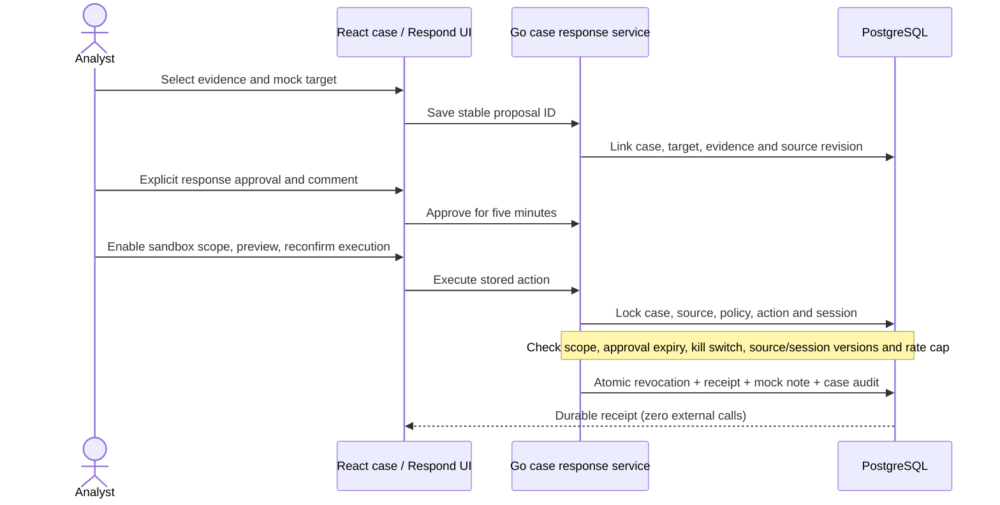

# Investigate → Respond: approved mock session revocation

Updated 2026-11-01. Local/mock only. This reuses the sandbox executor; it does not
connect an identity provider or enable production response.

## Analyst flow

1. Import reviewed JSON through Build, or open an existing suspicious-login case.
2. Review the L1 evidence and uncertainty. If required, approve the **mock SOAR
   note** and wait for it to sync. This approval does not authorize revocation.
3. Under **Respond to this investigation**, expand **Propose a mock session
   revocation**. Select a separately granted sandbox response scope, enter a mock
   principal/session and review reference, explain the rationale, and select
   existing evidence references. Save the proposal.
4. Review the immutable target and evidence snapshot. Enter a response approval
   comment and explicitly confirm the exact session, evidence and scope. Approve
   sandbox revocation; approval lasts five minutes.
5. The sandbox scope kill switch starts stopped. An authorized operator must
   separately confirm enabling that scope. This switch affects all mock sessions
   in the scope; it never supplies approval for individual actions.
6. Preview the decision, confirm the target again, and execute mock revocation.
7. Read the stored receipt and mock SOAR note reference. Reloading or replaying
   the same action returns the same result. The case is not automatically closed.
8. Stop sandbox execution after the exercise. Revocation cannot be undone;
   create a new mock session to simulate reauthentication.

Respond **Overview**, **Approvals**, **Action records**, and **Activity** display
case-linked records and link back to the owning investigation. Approvals shows
unexecuted proposals; Activity shows executed receipts. These records are separate
from generic remediation records, whose controls cannot execute them. Lists show
at most the latest 100 proposals; use the case view for its retained history.

## Configuration and boundaries

Reuse an existing trusted stream scope with `allow_sandbox_response: true`, matched
to the authenticated operator and tenant. All API choices are resolved against
server configuration. No new grant is inferred from a case, request payload, model
output, Build profile or note approval. Build-generated scopes still have response
execution disabled. A separately authorized mock identity scope may operate on a
case in the same tenant, including a case produced by a Build profile.

The principal and session are explicitly chosen **simulated targets**; the system
does not claim to have discovered a live IAM session. The proposal requires a
verified `mock-v1` review, a synced mock L1 note, and references belonging to that
case's worker evidence. It stores references, hashes, event times/types and the
rationale, without copying context payloads into the response snapshot.

Go enforces every action. Python verdicts remain advisory. Production configuration
continues to reject sandbox-response grants. No live credentials are required.

## Contracts and storage

- `GET /api/v1/investigations/{id}/sandbox-responses`: tenant-scoped case records
  and the authenticated operator's eligible sandbox scope identifiers.
- `POST /api/v1/investigations/{id}/sandbox-responses`: `propose`, `approve`,
  `dry_run`, `execute`, or `policy`. Approval requires `confirm: true` and a
  10–2000-character comment. Execution and policy changes require confirmation.
- `GET /api/v1/sandbox-responses`: tenant-scoped response handoffs for Respond.

The proposal request has a stable client-generated `id`, `scope_id`, `session_id`,
`principal_ref`, `ticket`, `reason`, and `evidence_refs`. Reusing its ID with changed
target/rationale/references conflicts. After an uncertain network result, refresh
and inspect the stored proposal before retrying. Approval/preview/execution use
the stored target, not replacement fields supplied by the caller.

Additive migration **043** creates `case_sandbox_responses` (durable linkage,
evidence snapshot, approval comment and receipt) and `mock_soar_response_notes`
(append-only response notes). Existing session/action/policy tables retain their
purpose. New persistence queries are generated by sqlc/pgx in `responsesql`.

## Failure handling and rollback

The existing executor keeps session-version checks, a 10/minute scoped rate cap,
100-session/action retention bounds, five-minute approvals and idempotent effects.
Expired approvals can be explicitly renewed after review. The legacy stream
endpoint rejects case-linked actions, preventing receipt/note bypass.

Revocation, action state, mock response note, source-version update and case audit
commit in one transaction. Audit/note failure rolls everything back. Source
revision conflicts do not overwrite analyst edits or revoke the session: inspect
the latest source and create a new reviewed proposal. Pending old proposals are
not silently rebased or cancelled. Response note approval does not reuse the
separate L1 mock-note approval.

Operational rollback: stop sandbox execution and remove the response grant to
make the UI read-only. Keep migration 043 and its history; reverting to an older
executor binary could bypass case linkage, so disable response grants before any
binary rollback. No destructive down migration or infrastructure addition is needed.

## Validation

The disposable `check.py --with-streams` suite includes
`check_case_response.py`, covering case/tenant isolation, absent grants,
fabricated evidence, proposal replay/conflicts, explicit approval, stopped and
expired execution, legacy bypass denial, source conflicts, audit rollback, and
four concurrent execution attempts producing exactly one effect and one note.
Its report is `output/backend-framework/case-response-flow.json`.

`case-response-browser-check.js` exercises proposal recovery, approval,
kill-switch preview, reconfirmation, receipt reload, Respond navigation and
read-only behavior using intercepted writes. Local retained-demo validation is
reported separately; neither is live-provider certification.

### Retained local showcase

The browser-driven local demo passed on 2026-11-01:

- Investigation: `INV-d58a2be3-c4a5-43c7-bbfc-bfea4afba822`.
- Response action: `621dbbde-838f-4e35-9619-289005f22c7b`.
- Mock SOAR response note: `bb48b005-c205-4a5b-b16a-571065ac121b`.
- Result: executed once, receipt survives reload, visible through Respond Activity,
  zero external calls, sandbox kill switch restored to **stopped**.

Open [the showcase investigation](http://localhost:8080/investigations/INV-d58a2be3-c4a5-43c7-bbfc-bfea4afba822)
or [Respond Activity](http://localhost:8080/respond/activity).
`case-response-demo.js` is explicitly a **mutating local showcase script**, not a
read-only smoke test. It reuses the retained proposal on repeat runs and stops the
execution gate in cleanup. Screenshots are under
`output/playwright/case-response-live-{1440,390}.png`.

### Completed verification

- Full disposable Go/PostgreSQL/Redis/Rust/Python framework check, including Go
  race tests and vet: passed with the new HTTP response-flow assertions.
- Additional disposable PostgreSQL domain/HTTP race suite: passed.
- sqlc generated-code diff check: passed.
- Case-response browser regression, retained local showcase, and existing Respond
  workflow regression: passed at desktop/mobile sizes.
- Frontend lint, production build, nine frontend Node test files, and Markdown
  link validation: passed. The existing large JavaScript chunk warning remains.

No live provider, production deployment, high-throughput claim or independent
multi-person approval guarantee is implied by these local tests.
