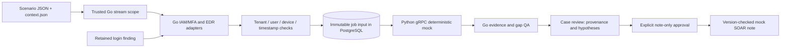

# Local IAM/MFA and EDR JSON adapters

The suspicious-login flow accepts optional, bounded JSON observations from mock
IAM/MFA and EDR sources. Go owns matching, normalization, snapshot persistence,
QA and note authorization. Python interprets typed evidence over the existing gRPC
service. No provider endpoint, model, executable script or credential is introduced.
The Go backend, Redis delivery, PostgreSQL jobs and analyst gate remain unchanged.

## Flow and ownership



`backend-go/internal/modules/logincontext` implements the adapters. The scope's
optional `mock_login_context` bundle is trusted configuration, not a free-form
payload-selected tenant or arbitrary file path in an HTTP request. Go matches its
tenant, principal and asset against retained login observations before enqueueing.
All grants for the same tenant/connector/source must agree on context and review
policy, even across processors. A configured context requires analyst review.

The existing `jobs.input` protobuf stores the complete normalized snapshot:
source/connector, user/device references, observation and retrieval time, reported
outcome, freshness state, bounded process metadata, citation and content hash.
Hashes cover the canonical JSON observation, tenant, evidence type and subject
binding. They identify synthetic input; they do not prove a provider signature.
Replaying unchanged inputs is idempotent. Changing context for an existing job
conflicts rather than overwriting its evidence or regenerating a note. Use a new
source scope for a distinct fixture run. No new table or migration is required.

## JSON contract

See `examples/scenarios/login-context/*/context.json`. A bundle contains:

- `schema_version: "1"`, `tenant_id`, `principal_ref`, `asset_ref`.
- `max_age_seconds`: 1–3600, applied relative to the historical successful login.
- `iam`: zero to two observations; `outcome` is `passed`, `denied` or `unknown`.
- `edr`: zero to two observations; `outcome` is `clean`, `suspicious` or `unknown`.

Each observation has a connector ID, unique reference, `observed_at`, `retrieved_at`
and outcome. EDR can include up to four process records: PID, parent PID, image
identifier and SHA-256. This is a bounded process snapshot, not a reconstructed or
complete endpoint tree. Missing process metadata leaves the endpoint evidence gap
open even if a source reports clean. IAM cannot include process records. Identifier
and hash allowlists exclude arbitrary instructions, URLs with parameters and shell
commands. The adapter never downloads, opens or executes referenced content.

Observation time must not be in the future; retrieval must be between observation
and current time. Observations after the login or older than the configured window
are marked stale. A recent retrieval does not make an old observation fresh. These
fixtures describe October 29 historical activity, not current provider health.

## Interpretation and safety

Typed `EvidenceContext` extends `EvidenceItem`; `Hypothesis.neutral_refs` preserves
observations that cannot support either explanation. There are no tool requests or
response credentials in this contract. Available MFA pass/EDR clean observations
are counterevidence to compromise; MFA denied/EDR suspicious observations support
that hypothesis. These are deterministic fixture interpretations, not causal proof.
Stale, unknown and incomplete endpoint observations are neutral/not assessed.

Go QA checks citation membership, coverage, duplicate/contradictory citation use,
neutral treatment of unusable context, and exact gap labels. Conflicting available
outcomes from the same evidence category produce `conflicting_context`. Present
fixture context always retains `independent_verification`. All mock verdicts remain
**INCONCLUSIVE**, require human review and leave the case open. Analyst approval
still authorizes only the mock note. The note now uses the verified result's gap
labels rather than a hardcoded missing-IAM/EDR sentence.

Context is currently allowed only in `mock-v1`; the real-model adapter contract has
not been expanded or validated. No precision/recall or model-quality claim applies.

## Run the scenarios

From the repository root, configure each desired scenario and restart once:

```bash
./run.sh suspicious-login --configure --config examples/scenarios/login-context/corroborating/scenario.json
./run.sh stop backend
./run.sh start backend
./run.sh suspicious-login --config examples/scenarios/login-context/corroborating/scenario.json
```

The runner reads `context_file` relative to the scenario directory, limits it to
32 KiB and refuses path escape or a different tenant. Configuration merges the
bundle into the existing local grant file without replacing different grants.
Choose another directory below for its corresponding fixture:

| Scenario | Expected context | Required gaps |
|---|---|---|
| `corroborating` | MFA passed, EDR clean with process snapshot | Independent verification |
| `suspicious` | MFA denied, EDR suspicious | Independent verification |
| `missing` | MFA present; no EDR response | Endpoint context, independent verification |
| `conflicting` | MFA passed and denied observations; EDR clean | Conflicting context, independent verification |
| `stale` | Both observations outside the login window | IAM/MFA, endpoint context, independent verification |

Each has a dedicated connector ID and four login events. The runner validates the
expected evidence count and gap set, then replays input to check deduplication.
Inspect its `case_id` at `http://localhost:8080/investigations/<case_id>`; the L1 panel
shows context source, outcome, freshness, retrieval time, user/device, process
metadata, hashes and supporting/counter/neutral citations.

Use the UI for human note approval. For a clearly labelled automated test only,
append `--approve-mock-note --comment 'Automated fixture review; mock note only.'`.
This simulates analyst authorization and is not evidence of a human review.

## Validation and rollback

Run the scenario loader unit tests, Go adapter/config/QA tests and full
`python3 scripts/framework/check.py --with-streams`. The framework uses disposable
PostgreSQL/Redis and real local Go/Python gRPC processes. It exercises all five
fixtures through withheld note, approval, synchronization and duplicate replay.
Negative cases cover foreign identity, malformed/future timestamps, excessive
bounds, duplicate citations, unknown outcomes, changed snapshots, conflicting
configuration and output that omits gaps or attempts benign closure.

Deploy the generated Go/Python contracts together and restart both workers. Older
strict workers reject unfamiliar context fields. Pause context-enabled scopes
before rolling back binaries, retain jobs/receipts and keep the previous no-context
scenario available. Do not remove snapshot data or replay it with a weaker gate.
The existing local demo remains configurable; live API validation and real-model
integration are still separate work.

## Retained demonstration cases

These local cases contain the JSON evidence and explicitly simulated review receipt:

- [Corroborating context](http://localhost:8080/investigations/INV-1d305aab-3b3c-4bad-8f63-d5feb45f9a44)
- [Suspicious context](http://localhost:8080/investigations/INV-4abae556-b88c-466b-9234-c11acdbae1e9)
- [Missing EDR](http://localhost:8080/investigations/INV-5e0a7c5d-0272-4431-8176-bd3826919fd7)
- [Conflicting MFA](http://localhost:8080/investigations/INV-6928f1c7-ba98-4291-9f02-e13d93935725)
- [Stale context](http://localhost:8080/investigations/INV-53ee039d-d1de-451a-9b83-b63f0b69ecc7)

Fresh installations generate their own case IDs; use the runner report there.
