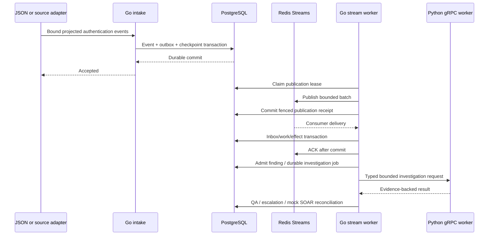
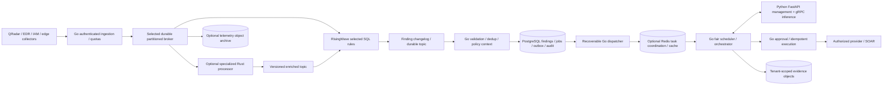
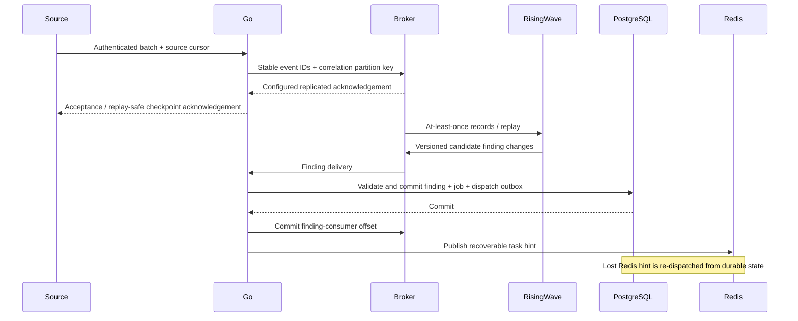

# RisingWave and aggregate 1M EPS: repository review

Date: 2026-10-31. Baseline: commit `798d8e3`. This reviews the user's proposed
multi-tenant architecture; it does not change the selected local runtime.
1M EPS means aggregate raw telemetry, not requests, findings or LLM investigations.
The latest measured local transport series was 1,103 / 1,102 / 948 EPS with
p95 0.343 / 14.216 / 2.950 seconds. The stability gate failed. See
[measured evidence](benchmarks/snapshot-flags-2026-10-31.json).

## Decision and corrections

Evaluate RisingWave for declarative, stateful SQL correlation. Evaluate **one**
Kafka-compatible durable backbone for the proposed high-volume data plane. Keep
the working PostgreSQL/Redis sandbox and Go control plane. No broker or RisingWave
service is installed or enabled by this review. [ADR 006](adr/006-streaming-data-plane-evaluation.md)
records the evaluation decision and the still-deferred adoption decisions.

The main migration is the durability boundary, not a language replacement. Today
`eventstate.Store.Accept` commits each event, outbox intent and source cursor to
PostgreSQL. `ClaimBatch`, receipt commits and consumer inbox/work commits add more
per-event state. Adding downstream CDC would retain those writes and cannot
remove their WAL synchronization bottleneck. A future broker-first path must
acknowledge sources only after its declared durability boundary, retain replay
offsets and reconcile uncertain acknowledgements before retiring the old path.

Correct the proposed graph in four places:

1. Findings enter **Go validation → PostgreSQL finding/job/outbox transaction →
   optional Redis dispatch**. Redis loss must not erase accepted investigations.
2. Rust publishes enriched records into a versioned topic. RisingWave consumes
   raw or enriched topics according to the rule, not both copies accidentally.
3. Go owns rule deployment and finding admission; RisingWave owns only selected
   streaming rule execution. Do not run equivalent Go/Rust/RisingWave rules as
   independent live incident producers. Shadow comparisons use separate IDs.
4. Distinguish preliminary threshold crossing from finalized window output.
   A five-minute window that emits only on closure cannot promise sub-second
   detection from the first event. Define latency from the decisive event and
   report watermark delay separately; corrections/retractions need a contract.

## Inventory and gap matrix

Implemented means repository code exists for the stated bounded capability, not
production readiness. Unknowns are called out explicitly within partial rows.

| Capability | Status / action | Repository evidence | Gap and severity | Dependency / acceptance |
|---|---|---|---|---|
| Go control plane | Implemented / keep | [API](../backend-go/cmd/api), [HTTP transport](../backend-go/internal/transport/httpapi) | Shared local deployment, not distributed SaaS | Preserve API parity and demo |
| Tenant-bound event contract | Implemented / extend | [telemetry.Binding, Event.Validate, Decode](../backend-go/internal/modules/telemetry/contract.go) | V1 allows authentication events only; no arbitrary security telemetry | Versioned broader projection; forged binding rejection |
| External connector authentication | Partial / extend | [auth middleware](../backend-go/internal/platform/auth/auth.go), [scoped import](../backend-go/internal/transport/httpapi/stream_mock_import.go) | P0: local mode accepts a tenant header; token mode binds operators, not a complete connector identity service | Separate service principals, rotation, audience/scope checks; local mode forbidden on shared deployments |
| SIEM/SOAR/Sentinel | Partial / keep | [QRadar](../backend-go/internal/modules/integrations/qradar.go), [Ariel](../backend-go/internal/modules/integrations/ariel.go), [Sentinel](../backend-go/internal/modules/integrations/sentinel.go), [SOAR sync](../backend-go/internal/modules/soarsync) | Installed versions, scopes and live behavior unknown; offense polling is not a 1M EPS raw-log export | Version-specific sandbox contracts; replay/checkpoint tests |
| Durable telemetry | Implemented / retain for sandbox | [Store.Accept/ClaimBatch](../backend-go/internal/platform/eventstate/store.go), [Runtime](../backend-go/internal/modules/telemetrypipeline/runtime.go) | P1: per-event PostgreSQL writes; local 100k retained-record ceilings | Broker-first boundary and replay evidence before cutover |
| Redis transport/cache | Implemented / keep | [streams](../backend-go/internal/platform/streams), [enrichment](../backend-go/internal/modules/enrichment), [ADR 005](adr/005-redis-streams-boundary.md) | Not a long-retention 1M EPS backbone | Preserve cache isolation and current recovery tests |
| Kafka/Redpanda | Missing / evaluate one | No client/deployment found in backend, service, contract or deployment inventory | P1: no producer acknowledgements, partition plan, broker ACLs or offset reconciliation | Broker fault/replay evaluation; no default activation |
| SQL correlation | Missing before this experiment / add shadow POC | [new experiment](../backend-go/internal/experiments/risingwavepoc) | SQL/runtime parity and state expiry require validation | Match existing Go evidence sets; duplicates, delayed events and mixed tenants |
| Existing correlation | Implemented / keep as oracle | [SuspiciousLogins](../backend-go/internal/modules/telemetry/correlate.go) | 100-event authoritative snapshot; three failures before success within five minutes; not distributed stream processing | Preserve exact rule version and evidence semantics |
| Rust telemetry engine | Partial / defer expansion | [WASM worker](../services/wasm-worker), [worker contract](../contracts/proto/aisoc/worker/v1/worker.proto) | Optional bounded specialist, not current high-volume parser/correlator | Parser CPU profile before adding another per-event RPC hop |
| Python/FastAPI/gRPC | Implemented / keep | [service](../services/python-worker/service.py), [model adapter](../services/python-worker/model_adapter.py), [typed task/result](../contracts/proto/aisoc/worker/v1/investigation.proto) | Real provider quality/latency not validated; local mock selected | Model evaluation independent of telemetry EPS |
| Findings and durable jobs | Implemented / extend | [AdmitFinding](../backend-go/internal/modules/intake/findings.go), [QueueMock](../backend-go/internal/modules/l1/queue.go), [jobs.Store](../backend-go/internal/platform/jobs/jobs.go) | Queue is PostgreSQL today; Redis priority dispatch is proposed | Transactional finding + job + outbox; replay cannot duplicate cases |
| Fair scheduling | Partial / extend | QueueMock tenant active cap; jobs.Claim ordered by availability/time | P0 at scale: cap is not weighted fairness or reserved critical capacity | Hot-tenant starvation tests, admission/token budgets |
| Policy and responses | Partial / keep disabled for live use | [QA](../backend-go/internal/modules/l1/qa.go), [sandbox sessions](../backend-go/internal/modules/response/sandbox_sessions.go) | Sandbox grants/revocation do not certify live containment | Explicit provider scope, approval expiry, uncertain-result reconciliation |
| Database tenant isolation | Partial / harden | Composite tenant keys and scoped SQL in [migrations](../backend-go/migrations), eventstate and intake | No RLS policies found; privileged DB access bypasses application filters | Role/RLS strategy or dedicated data planes; negative SQL tests |
| RisingWave tenant authorization | Missing / design | No runtime or grants in existing deployment | Tenant predicates alone are not a security boundary; version-specific resource isolation unknown | Go-only access, separate credentials/deployments for stronger isolation |
| Evidence archive | Partial / extend | [archive.go](../backend-go/internal/platform/eventstate/archive.go), [archive restore check](../scripts/framework/archive_restore_check.py) | Local files, not validated tenant IAM/object-storage lifecycle at PB scale | Tenant-bound object access, retention and restore drills |
| Metrics and load testing | Partial / extend | [load harness](../backend-go/internal/modules/telemetrypipeline/load_test.go), [gate](../scripts/framework/performance_gate.py) | 60k synthetic transport probe, ~490-byte envelopes, not multi-host 1M EPS | Dedicated generators and realistic skew/size distributions |
| Dedicated data planes | Missing / add after design | Local supervision in [framework scripts](../scripts/framework) | No tenant placement, separate keys or regional recovery automation | Deployment isolation tests and migration runbook |
| Production scale/cost proof | Missing / measure | No verified broker/RisingWave benchmark | P1: no capacity or dollar estimate can be certified | Hardware/provider rates, retention, compression and failure budget |
| Raw telemetry to LLM | Not applicable / prohibit | Current QueueMock is finding-driven | A million model tasks/sec is outside the target | Separate findings/sec and model concurrency budgets |

## Current lifecycle

## Proposed target, not deployed

Do not acknowledge a source on an in-memory enqueue. A lost producer ACK can mean
the broker committed: retry the same event identity. Define exact broker failure
assumptions, offset retention and source cursor reconciliation. Source corrections
must not be inferred by lexicographically sorting opaque revision IDs.

## Contract reuse and extensions

Keep `telemetry.Event`/`Finding` v1 and existing investigation protobufs unchanged.
Introduce a separately versioned broker envelope only after review: authenticated
tenant/connector/source, existing event identity/content hash, source revision,
event/ingest times, correlation key version, payload schema, evidence reference,
trace context, broker position and replay generation. Tenant identity is derived
by the gateway; mismatched body values are rejected, not used for routing.

The projected auth columns needed for SQL are inside the current JSON/bytea
envelope. PostgreSQL CDC alone does not provide a typed auth stream automatically.
Define one validated projection and canonical IP representation in Go. Do not
introduce a second identity/hash algorithm in SQL.

Future finding changes need stable rule-instance identity, rule version, revision,
provisional/final/retracted status, evidence set/hash, event-time bounds and
watermark/late-data policy. Existing finding identity hashes evidence keys; adding
late evidence can change that identity. Production admission therefore needs an
explicit suppression/update contract before enabling streaming findings. The POC
compares finalized finite evidence sets and never admits incidents.

Reuse typed task/result fields (`tenant_id`, task/attempt IDs, deadline, evidence
hashes) and existing Go sandbox response authorization. New policy decisions and
response contracts must carry tenant, policy version, expiry, target scope,
approval identity, idempotency key and uncertain-outcome reconciliation state.
Do not expose RisingWave, SQL credentials or provider credentials to LLM workers.

## Incremental PR plan

Current delivery: repository review, diagrams, threat model, ADR and Go reference
fixtures are complete. SQL parity harness is prepared; actual RisingWave execution
was approved but subsequently deferred by the user after the local disk constraint.
R1–R6 are planned changes, not implemented capabilities. The next application
foundation task is R1's authenticated connector identity/tenant mapping, before
adding a broker or admitting streaming findings into live investigations.

| PR / dependency | Concrete changes | API/schema/migration | Acceptance / metrics | Risk and rollback |
|---|---|---|---|---|
| R0: this review | This document, ADR 006, isolated `internal/experiments/risingwavepoc` | No live schema/API changes | Go oracle fixtures; optional real RisingWave parity report; explicit skipped/unmeasured labels | Remove experiment; default runtime unchanged |
| R1: R0 security review | `platform/auth`, `platform/config`, connector ingress, telemetry contract; service-principal mapping | Additive connector identities/credential rotation; versioned projection | Forged tenant/source, revoked token, oversize input, IP canonicalization; per-tenant rejects | New ingress feature disabled; old demo retained |
| R2: R1 + broker decision | New `platform/eventlog`, broker gateway, `deploy/streaming`; choose Kafka OR Redpanda | Broker envelope v2; source cursor reconciliation store | ACK-loss, outage, leader failover, replay, quota/backpressure; lag and durable-ACK latency | Shadow-only topic; no source acknowledgement cutover until verified |
| R3: R0/R2 | Versioned RisingWave rules and rule-deployment controller | New isolated SQL objects; finding changelog v2 | Go parity, late/beyond-watermark routing, corrections, hot keys, state expiration; state bytes/finding latency | Disable selected rule; preserve broker replay; parallel rule-version validation |
| R4: R3 | Extend `intake.AdmitFinding`, finding consumer, `jobs`, dispatch outbox | Additive suppression/update and offset receipt tables; retain existing IDs | Atomic failure/replay cannot duplicate incident/job; Redis restart recovers dispatch | Stop consumer and retain offset; shadow findings remain separate |
| R5: R4 | Tenant admission and scheduler, model budgets, response gate | Additive tenant quotas/weights/critical reservations | No starvation; bounded cost/concurrency; approval/expiry/kill-switch and ambiguous provider result tests | Disable new dispatch; existing durable job records retained |
| R6: R2–R5 + capacity environment | Distributed generators, broker/RW dashboards, dedicated deployment templates | No breaking migration without separate approval | Staged 1k→10k→50k→100k→1M EPS; recovery, skew, 2x bursts, drain, retained replay | Return traffic to prior validated stage; no irreversible cutover |

Each PR records exact selected versions/image digests, results, workload hash,
resource limits and rollback procedure. New infrastructure activation, breaking
migrations and privileged response enablement require separate review/approval;
the local POC code does not activate them through `run.sh`.

## Capacity, SLO and cost model

The supplied raw-payload arithmetic is correct for decimal 2,000-byte events:
2 GB/s = 16 Gbit/s ingress, 172.8 TB/day, 5.184 PB/30 days. A 60-second 2M EPS burst
contains 240 GB raw payload; at 1M EPS downstream capacity it adds 120 GB backlog.
These exclude protocol, indexes, state, replication, safety margin and compression.
Five minutes of 1M EPS is 300 million events / 600 GB raw before join fan-out.

Do not set a partition count from EPS alone. Measure per-partition sustainable
throughput under replication, hot-key skew and recovery, then reserve headroom.
Use a stable hash of tenant + chosen entity + key-version, not tenant alone.
Multi-key rules require explicit repartitioning and state/network cost accounting.
Bound stream-stream joins and dimension-table history; define idle partitions and
late-event behavior. A 5-minute window and a sub-second finalized detection SLO
need separate start/end definitions, not an average latency shortcut.

Minimum sizing inputs: event mean/p95/p99 sizes; tenant mix/skew; retention hours;
compression; replication/failure domains; unique entities/window; rule count and
join selectivity; finding yield; replay speed; regional transfer; CPU/RAM/storage
measurements. Cost worksheet: broker retained bytes = ingress bytes/s × retention
seconds × replication ÷ measured compression; add independent archive, RW state,
object requests, compute, cross-zone/egress and operational support. Dollar cost is
**unknown** until provider, topology and prices are selected; no invented monthly bill.

At finding yields 0.001%, 0.01%, 0.1%, 1M EPS becomes 10/100/1,000 findings/sec.
At 60 seconds per investigation, unrestricted concurrency would be 600/6,000/
60,000 calls. Use tenant budgets, suppression, deterministic enrichment and
admission; model throughput is a separate capacity plan.

Release measurements must include offered/accepted/durable/completed rates,
event-to-finding p50/p95/p99, watermark lag, task delay, queue age, duplicate effects,
replay gaps, CPU/RAM/disk/network, broker replication health, RW state/checkpoint
age and cost per event/finding/investigation. No 1M EPS test on this shared local
host is credible; its stable 1k gate is already unmet. Standalone RW cannot prove
multi-node failover. SaaS versus edge deployment and hard tenant-isolation service
tiers remain open decisions.

## Evidence and external references

The optional experiment and its limits are documented in [the POC guide](RISINGWAVE_POC.md).
The [threat model](MULTITENANT_STREAMING_THREAT_MODEL.md) defines negative gates.

- [RisingWave architecture](https://docs.risingwave.com/get-started/architecture): persistent streaming state and separate runtime roles.
- [RisingWave ingestion](https://docs.risingwave.com/ingestion/overview): verify selected connector paths; Redis sink support does not imply Redis Streams source support.
- [RisingWave watermarks](https://docs.risingwave.com/processing/watermarks): late-event semantics must be tested against the selected version.
- [RisingWave table conflicts](https://docs.risingwave.com/sql/commands/sql-create-table): POC replay handling is not a replacement for identity/content validation.
- [RisingWave standalone limitations](https://docs.risingwave.com/deploy/risingwave-docker-compose): not a production HA validation environment.
- [Kafka durability settings](https://kafka.apache.org/42/configuration/topic-configs/): producer acknowledgements, ISR and replication jointly define guarantees.
