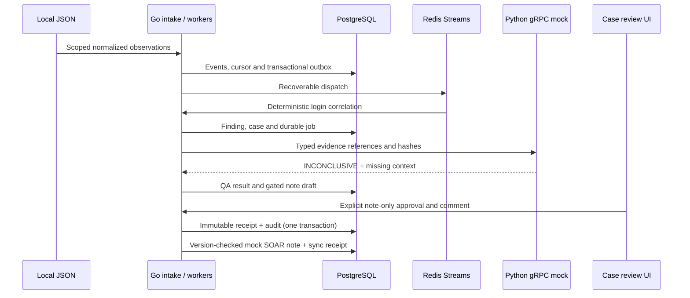

# Suspicious-login end-to-end local scenario

This scenario reuses the Go-first framework. Four synthetic authentication observations
(three failures followed by success, deliberately supplied out of order) produce one
finding, one case and one durable Python mock investigation. Go verifies the result.
An opt-in analyst gate prevents the mock SOAR note from being written until approval.
The case stays open. No external provider, real model or containment is involved.



## Run and inspect

Use the existing local **foundation** profile (API 3003, frontend 8080), never the
preserved release on 3002. The runner expects local-development authentication.

```bash
./run.sh suspicious-login --configure
./run.sh stop backend
./run.sh start backend
./run.sh suspicious-login --output output/suspicious-login/before-review.json
```

`--configure` merges one grant into `.run/go-dev/stream-scopes.json`, refusing to
overwrite a different grant. Restart loads it and applies additive migration 041.
The runner imports the file, waits for verified evidence and `awaiting_review`, then
reimports it to verify deduplication. Open `/investigations/<case_id>` on the frontend
using the ID in the report. The L1 review panel shows evidence, competing hypotheses,
missing IAM/MFA and endpoint context, and the note-approval stage. Choose **Review
mock SOAR note**, enter a comment and confirm the note-only scope to approve.

For an explicitly simulated approval in an automated local demonstration:

```bash
./run.sh suspicious-login --approve-mock-note \
  --comment 'Automated sandbox demonstration: reviewed evidence and missing context; mock note only.' \
  --output output/suspicious-login/after-review.json
```

The flag represents a test operator, not proof of human review. It exercises
idempotent approval retries. A later ordinary run verifies replay without creating
another event, case or note. Existing receipts cannot be overwritten.

## Configurable integrations

`examples/scenarios/suspicious-login/scenario.json` is the versioned configuration;
`events.json` contains normalized synthetic QRadar-shaped observations. Use
`--config /absolute/path/scenario.json` for another local fixture directory. The
loader limits file size, requires matching trusted scope identities, disallows
path traversal and redirects, and accepts only local HTTP origins outside port3002.
Keep event IDs stable for replay. Use a dedicated connector scope per independent
scenario; this runner intentionally expects exactly one finding from four events.

Provider settings remain in existing connector configuration. This test does not
claim compatibility with any installed QRadar API version. Python stays an
independent FastAPI/gRPC service; the investigation call uses typed gRPC and its
existing deterministic mock implementation. The current Go login correlator is
reused; introducing Rust here needs a measured advantage. Detection/Routing, Hunt,
Threat Intel, Memory and Build retain their existing workflows; this slice does not
claim that all their production integration gaps are closed.

## Approval and recovery boundary

The source grant has `require_analyst_review: true`, `allow_mock_import: true` and
`allow_sandbox_response: false`. The worker persists the gate on `l1_escalations`.
All import grants for the same worker binding must agree on the gate. `SyncMock`
locks the escalation and returns `awaiting_review` until approved. Approval is bound
to authenticated actor, tenant, connector and source, and records actor, comment
and timestamp atomically with the audit event. Identical retry succeeds; a changed
receipt conflicts. A source-version conflict still requires explicit reconciliation.
Approval cannot change the verdict, close the case or authorize a response.

Existing sources default to the previous ungated behavior. This opt-in gate is for
mock note write-back, not a universal response-authorization policy. Retain the
migration and receipts when rolling back. Pause the scoped worker before reverting
to a binary predating the gate: that older binary cannot enforce it. Do not delete
records to retry a demo. Pausing/restarting workers preserves durable checkpoints.

## Verification

```bash
python3 -m unittest discover -s scripts/framework -p test_suspicious_login.py
python3 scripts/framework/check.py --with-streams
make -C backend-go sqlc-check
cd frontend && npm run lint && npm run build
```

The framework harness uses disposable PostgreSQL/Redis, the real Python gRPC mock
worker and Go HTTP/dispatch paths. It verifies withheld write-back, tenant/operator
rejection, one approval audit, one note and replay. Store tests cover source scoping,
gate downgrade rejection and rollback on audit failure. Browser checks exercise the
real projection and intercepted approval/error states without live provider calls.
Generated reports live under ignored `output/`; see [Testing](TESTING.md) for results.
This demonstrates contract correctness with synthetic evidence, not model accuracy,
production durability or live provider validation.

## Local IAM/MFA and EDR context

[Configurable JSON adapters](LOGIN_CONTEXT_ADAPTERS.md) extend the suspicious-login flow with
tenant/subject-bound provenance, typed gRPC snapshots, contextual hypotheses and
explicit missing/stale/conflicting evidence. Five historical fixtures remain
INCONCLUSIVE and require note approval; no live provider or model is activated.
