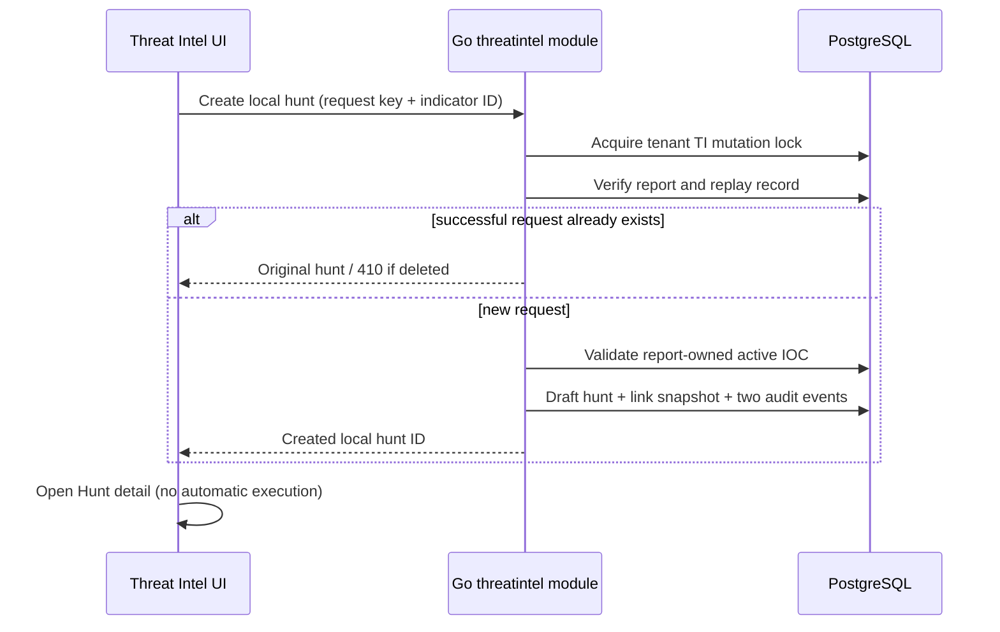

# Threat Intel workspace

Implemented locally on 2026-11-01. The verified public reference is [7AI's Threat Hunting page](https://7ai.com/platform/threat-hunting), specifically [the Threat Intelligence Hunting screenshot](https://47518862.fs1.hubspotusercontent-na1.net/hubfs/47518862/hunt-threat-intel-browser-2.png). Its browser URL is `app.sevenai.com/hunt/threat-intelligence`. A separate public Threat Intelligence detail screenshot set was not verified; AISOC's report detail is a functional extension using the same visual language, not a claim of pixel-for-pixel vendor detail replication.

## Screens and behavior

`/threat-intel` and `/hunt/threat-intelligence` now share one report registry. It follows the reference's metric cards, search/filter row, report/source cells, actor, targeted industry, targeted region, publication time and status columns. `/threat-intel/{id}` provides report text, analyst metadata, paginated indicators and related local hunts. Existing tenant-scoped breadcrumbs remain in use.

The old Threat Intel fallback reports/IOCs, decorative date filter, automatic-scanning copy and counter-only “Launch Hunt” UI have been removed. Empty results stay empty, missing reports show an error, and failed requests do not substitute examples.

- Counts describe the complete filtered report set, not just a page and not a fictitious 30-day investigation metric. Sources are distinct stored source labels, not proof of connected feeds.
- Reports sort by publication time descending with an ID tie-breaker; pages contain 50 reports. Search is literal, case-insensitive over title, summary, source, actor, industry and region.
- Relevance is an explicit analyst boolean. `new`, `reviewing`, `actionable` and `archived` are report-review states, not malicious/benign investigation verdicts.
- Unknown actor/industry/region remain blank/“Not recorded”. These metadata strings are analyst-supplied, not model-derived facts.
- IOC counts come from actual `threat_indicators` rows, independently of legacy manually supplied `ioc_count`. Related-hunt counts come from recorded links, including retained links to deleted hunts.
- Report detail renders source content as text. IOC `hits` are labelled **Reported hits**, not verified findings. No provider activity or confidence is invented.

## Authoring and local hunts

Ingest a report using the form, edit its metadata/relevance/status, and add typed indicators. The existing report and indicator authoring APIs are reused. Report editing supplies `expected_updated_at`; a stale edit returns 409 and leaves the editor's draft available. Cancel and reload before resubmitting. Report/indicator timestamps advance monotonically for guarded updates. Existing API callers may omit the optional timestamp guard for compatibility.

Select **Create local hunt** on an active indicator. Go verifies tenant ownership, the indicator's membership in the report, active status and a 2–200-character search value. Archived reports cannot create new hunts. It then creates a **draft** hunt whose saved phrase is the IOC value, records an immutable link/value snapshot and appends hunt/report audit events in one transaction. The UI opens the hunt workspace; the analyst must separately select **Run local search**. This uses the bounded local evidence search described in [Hunt workspace](HUNT_WORKSPACE.md), not a SIEM query or LLM.

Retry identity is generated by the client and retained after uncertain network/server failures. Concurrent retries with the same request key, indicator ID and actor return the original hunt. Conflicting key reuse returns 409. An indicator value edited after creation does not silently change the existing hunt snapshot. A deleted hunt leaves its link/request record: retry returns 410 `HUNT_DELETED`, and the related-hunt row is disabled. A new request ID is required to intentionally create another hunt. Deleting the owning report cascades its links, but does not delete the hunts or resource audit.

There is deliberately no hunt foreign key on the replay table: retaining the target ID after deletion prevents a successful request from being recreated by a late retry. Availability is checked through a tenant-scoped indexed hunt lookup. A concurrent deletion immediately after creation may leave a unavailable target; the retained record still prevents duplicate replay. Late frontend mutation completions do not redirect the user after they navigate away.

## APIs and persistence

All paths below use `/api/v1`. Authentication supplies tenant and actor.

| Endpoint | Contract |
|---|---|
| GET `/threat-intel/registry` | `search` (≤200 characters), `status`, `relevant=true/false`, `limit` (1–100), `offset` (0–1,000,000). Returns `items`, filtered `total` and `sources` in one repeatable-read snapshot |
| GET `/threat-intel-reports/{id}/workspace` | Stored report, actual `indicator_count`, latest 100 local hunt links with `available` flags |
| POST `/threat-intel-reports/{id}/local-hunt` | `{id, indicator_id}`. `id` is a request key of 1–100 ASCII letters/digits/underscore/hyphen. Returns hunt ID and indicator/value/actor snapshot |
| POST/PATCH `/threat-intel-reports[/{id}]` | Existing API plus `threat_actor`, `targeted_industry`, `targeted_region` (≤200 characters each), strict boolean `relevant`; optional PATCH `expected_updated_at` |
| GET/POST `/threat-indicators` | Existing tenant/report-scoped pagination and authoring; the UI shows 50 rows per page |

Legacy `/threat-intel-reports/{id}/launch-hunt` is preserved for compatibility and remains counter-only. Neither new report screen uses it. Legacy manually supplied hunt/finding/IOC counters are not evidence of actual searches and are not used for the new registry's counts.

Migration `039_threat_intel_workspace.sql` adds four report metadata columns and `threat_report_hunts`. New projection/link SQL lives in `backend-go/internal/modules/threatintel/queries/workspace.sql` and is generated to `threatsql` with sqlc/pgx. Report edits, IOC reassignment/deletion and local hunt creation share the existing tenant advisory transaction lock. Hunt, link and both audit writes commit atomically. No new infrastructure or secrets are introduced.

## Tests, rollout and rollback

Verified with the isolated PostgreSQL race suite: metadata persistence, actual-vs-manual IOC counts, filtered totals/source counts, tenant isolation, stale edits, concurrent idempotent creation, report/indicator membership, audit rollback, archived-report refusal and deletion-safe replay. HTTP tests cover invalid filters, duplicate/unknown query keys, pagination bounds and malformed creation bodies.

`threat-intel-browser-check.js` uses intercepted domain fixtures for relevance filters, metadata CAS, IOC creation, related-hunt navigation, delayed-response navigation guards, desktop/mobile overflow and no sample fallbacks. The prior Hunt browser suite also passes against the shared registry. Mutations in browser fixtures do not alter demo data. Go vet, sqlc drift, frontend lint/build and frontend navigation tests pass; the build retains the existing bundle-size warning.

Apply migration 039 through normal local startup before loading the new frontend. Rollback is code-only: restore previous binaries/assets and retain additive columns/tables and audit history. Backups/retention must include analyst metadata and IOC value snapshots. Report deletion removes links by existing authorized deletion semantics; hunt deletion intentionally retains request tombstones. The UI displays the latest 100 links, but no automatic link archive/expiry is implemented.

Remaining: live TI feed ingestion/polling, STIX/TAXII adapters, model enrichment, deduplicated bulk report/IOC import, automatic relevance scoring, report-to-case verdict attribution and live provider hunt execution. These are not implied by source labels, report severity or local hunt creation.
