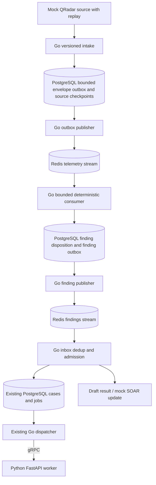

# Redis Streams amendment: repository review and proposed implementation

Status: reviewed; incremental sandbox implementation started with S01, 2026-10-29.
Repository baseline: `cff6c13`. Based on the supplied Redis Streams amendment and
the QRadar/agentic L1 brief in the conversation. Neither brief establishes that
live QRadar integration or AI investigation already exists. The original review
changed documentation only; Redis was absent at that baseline. Subsequent contract,
persistence and adapter work is tracked in [implementation tasks](IMPLEMENTATION_TASKS.md).

## Recommendation

Use Redis Streams first for bounded, replayable telemetry and finding handoff.
Keep existing PostgreSQL investigation jobs and specialist leases as durable
orchestration truth. Python remains the independent FastAPI/gRPC service controlled
by Go. Rust correlation is a future capability requiring benchmark evidence.
Do not add three overlapping investigation queue implementations.

Cache and stream workloads need separate budgets and failure policies. Begin with
an optional dedicated development Redis instance using `noeviction`, with cache
entries limited by application budgets/TTL. Do not change an unrelated host Redis.
If a separate evicting cache becomes necessary, propose that deployment explicitly.
Redis logical database numbers alone are not memory or fault isolation.

## Verified gap matrix

Existing paths are links. Proposed additions below describe the original plan;
the implementation tracker records which have subsequently been delivered.

| Requirement | Existing file / symbol | Status | Change | Risk / acceptance gate |
|---|---|---|---|---|
| Go ownership | [Go worker](../backend-go/cmd/worker/main.go), [ADR 004](adr/004-python-fastapi-grpc-service.md) | Implemented foundation | Keep | No Python orchestration or direct response credentials |
| Normalization and durable intake dedup | [intake/alerts.go](../backend-go/internal/modules/intake/alerts.go): `IngestSource`, `ingest`; [009 migration](../backend-go/migrations/009_alert_intake.sql) | Partial | Extend | Existing unique identity is tenant/source/external ID; changed content returns `ALERT_CONFLICT` |
| QRadar SOAR/SIEM connectors and replay | [connectors.go](../backend-go/internal/modules/connectors/connectors.go): `Store.Mutate` reports unsupported live adapter tests | Missing | Add | Separate source contracts; verify versions, scopes, cursor and replay windows |
| Durable local investigations | [processor.go](../backend-go/internal/modules/intake/processor.go): `ProcessNext`; [010 migration](../backend-go/migrations/010_investigation_processing.sql) | Implemented local phases; partial target L1 | Keep / extend | Do not perform remote calls while holding current phase transactions |
| Specialist scheduling/recovery | [jobs.go](../backend-go/internal/platform/jobs/jobs.go): `Enqueue`, `Claim`, `Complete`, `Retry`, `Cancel` | Implemented foundation | Keep | Atomic enqueue; leases, attempt fencing and retry exist; current retry is linear, not jittered exponential |
| Redis investigation queues replacing PostgreSQL jobs | Same job implementations | Incompatible with minimal additive rollout | Defer replacement | Would split retry, cancellation and attempt ownership without a migration design |
| Stream producer, consumer groups, recovery | [go.mod](../backend-go/go.mod), [deployment templates](../deploy/systemd) contain no AISOC Redis integration | Missing | Add | ACK only after durable disposition; crash/replay tests required |
| Outbox/inbox and source checkpoints | Current intake transaction and migrations have no stream outbox/inbox | Missing | Add | Prevent uncoordinated DB/Redis publication and duplicate business effects |
| Stream retries, DLQ, retention/backpressure | No stream runtime exists | Missing | Add | Must be in the first operational slice, not deferred past live delivery |
| Enrichment cache | No Redis cache integration in reviewed backend | Missing | Add after a consumer exists | Tenant/provider/schema/freshness scoped keys; no authorization or mutable case cache |
| Rust parse/correlate | [main.rs](../services/wasm-worker/src/main.rs): hashing and ASCII WASM transform only | Missing target processing | Extend only if measured | Batch representative data; compare Go baseline including RPC overhead |
| Python transport / AI reasoning | [service.py](../services/python-worker/service.py): `Runtime`, `create_app`; [worker proto](../contracts/proto/aisoc/worker/v1/worker.proto) | Implemented transport; missing AI reasoning | Keep / extend | Only normalization exists; bound future model/tool budgets |
| L1 admission / priority / fairness | Existing queues and four-RPC Python limit | Partial | Extend Go admission | Per-tenant fairness, model token budgets and reserved critical capacity remain work |
| Tenant boundaries | Tenant-scoped intake and job identities | Partial for streams | Extend | Derive tenant from trusted connector configuration, never trust envelope alone |
| Policy / response / SOAR reconciliation | [runbooks.go](../backend-go/internal/modules/response/runbooks.go), [remediations.go](../backend-go/internal/modules/response/remediations.go) | Partial local confirmation/simulation; missing external execution/sync | Keep / extend later | Approval checkbox is not privileged authorization; no containment in streaming slice |
| Telemetry observability | [metrics.go](../backend-go/internal/transport/httpapi/metrics.go): HTTP/pool/local job metrics | Partial | Extend | Add stream lag, pending age, replay gaps and rejection reasons without sensitive payloads |
| EPS, Redis edition/version, source replay capacity | [performance report](migration/PERFORMANCE.md) measures application requests, not telemetry EPS | Unknown | Measure / discover | No Redis throughput, loss tolerance or ingestion SLO established |

## Smallest proposed flow

Start with one partition per stream and one versioned deterministic test rule.
Use bounded projected attributes needed by the rule plus evidence references;
the example envelope's references alone are not enough to perform correlation.
Avoid per-event source fetches or Rust RPCs by default. Add partitions/batches from
measurements. A non-finding still requires a recorded processing disposition or
checkpoint before acknowledgment, not merely a metrics increment.

The outbox stores bounded envelopes/references, not a permanent raw telemetry copy.
Size and retain it explicitly. A source batch checkpoint and its outbox records
commit atomically before acknowledging acceptance. The relay publishes then marks
publication: a crash can duplicate delivery, so downstream durable dedup is required.
Do not delete recovery material merely because `XADD` succeeded. Redis loss after
publication requires retained replay material or verified source backfill through
a downstream completion watermark. If source replay cannot meet the required loss
window, this design is not ready for that source.

On each consumer boundary, commit a durable disposition/inbox identity and any
business mutation/outbox record in one PostgreSQL transaction, then `XACK`.
Crashing after commit but before ACK must replay without duplicate case/job creation.
For stateful correlation, checkpoint windows/state or deterministically reconstruct
them from replay; in-memory windows alone cannot support the claimed recovery.

## Corrections required before implementation

1. **Keep PostgreSQL jobs.** Omit `soc:investigations:*` streams initially. Go may
   schedule downstream work asynchronously using the existing queue and gRPC.
2. **Handle updates deliberately.** Add connector instance, event type and source
   revision to the new contract. Separate event occurrence identity from mutable
   SOAR case identity; retain existing HTTP intake conflict semantics. Define
   reopen/update ordering and stale-version handling rather than weakening dedup.
3. **Move core resilience into phase 1.** Durable dedup, ACK ordering, pending
   reclaim, bounded retries, durable error disposition/DLQ, backpressure and tenant
   admission are prerequisites for real traffic. DLQ failure must not ACK/drop work.
4. **Make stale ownership harmless.** Reclaim can overlap with a slow original
   consumer. Use durable uniqueness/version fencing for effects; Redis ownership
   or a TTL lock alone is not sufficient. Keep remote calls outside SQL transactions.
5. **Specify ordering.** Use event timestamps plus revision/sequence and a lateness
   policy. A partition or stream ID is not a guarantee of completed processing order.
6. **Cache only safe results.** Include tenant, connector, provider, normalized
   query and schema version in keys. Store fetched/expiry times and provenance.
   Use short negative-cache TTLs; a stale/missing lookup is never evidence of benign
   activity. On cache failure, bounded fetch or explicit missing evidence is valid.

Redis version must be pinned before implementation. `XAUTOCLAIM` begins at 6.2;
7.0 adds returned IDs for removed pending entries. Recovery cannot recreate trimmed
payloads from those IDs. Treat these as replay gaps, not successes.
[Redis XAUTOCLAIM documentation](https://redis.io/docs/latest/commands/xautoclaim/).

Do not use blind `MAXLEN` trimming to meet memory targets while claiming lossless
delivery. Account for every required group's completed and undelivered work; Redis
8.2 adds acknowledgment-aware controls, but those cannot be assumed on an unknown
deployment. Pause/reject intake before budgets are exhausted and test replay.
[Redis Streams documentation](https://redis.io/docs/latest/develop/data-types/streams/).

`noeviction` rejects memory-growing writes at capacity rather than evicting keys.
Cache eviction policies must not evict queue keys. Monitor memory headroom and
application budgets; do not treat a configured maximum as a full RSS bound.
[Redis eviction documentation](https://redis.io/docs/latest/develop/reference/eviction/).

AOF `everysec` has an acknowledged data-loss window; it is not a lossless failover
guarantee. Persistence, replication and source replay must be tested separately.
[Redis persistence documentation](https://redis.io/docs/latest/management/persistence/).

## Proposed file-level implementation sequence

All additions below are proposals, not delivered files or configuration names.

| Step | Proposed files / existing extension | Acceptance and dependencies |
|---|---|---|
| 1: contracts and ADR | `contracts/events/telemetry-v1.schema.json`, `contracts/events/finding-v1.schema.json`, `docs/adr/005-redis-streams-boundary.md` | Decide source revision semantics, size limits, tenant trust, replay horizon and retention; review diagram |
| 2: persistence | New migration after `019`, `backend-go/internal/platform/eventstate/` | Add bounded outbox, source checkpoints and durable consumer identity/disposition as needed; rollback-safe additive migration; no rewriting applied migrations |
| 3: Redis adapter | `backend-go/internal/platform/streams/`, extend `internal/platform/config/` | Publish batches, bounded reads, ACK, reclaim cursor, retry/DLQ, admission and metrics; pin compatible Go client and Redis version |
| 4: Go pipeline | `backend-go/cmd/telemetry-worker/`, `backend-go/internal/modules/telemetry/` | Mock source to finding to existing Go jobs; no HTTP contract break, no model per raw event |
| 5: local deployment | `deploy/redis/redis.conf.example`, extend `scripts/framework/dev.py` | Explicit opt-in AISOC instance, private ACL credentials, AOF, noeviction, maxmemory, lifecycle and log paths; remote TLS mandatory |
| 6: failure/load suite | `tests/streaming/`, `scripts/framework/check-streams.py`, extend HTTP metrics | Disposable Redis/PostgreSQL, source mock, loss ledger and reconciliation; never load-test the active release |
| 7: cache consumer | `backend-go/internal/platform/cache/`, future enrichment adapter | Add only with a real read use case and bounded tenant-aware fallback; measure saved calls and staleness |

Candidate settings: disabled-by-default streams flag, Redis address/ACL/TLS secret
references, message-size limit, partition count, bounded batch/block timeout,
claim idle threshold, retry cap/backoff, stream/outbox budgets and retention.
Validate threshold relationships at startup. Keep credentials out of flags/logs.
Readiness should distinguish optional pipeline health from core Go availability.

## Required release gates and observability

- Unit/contract: schema/version rejection, size limits, source revisions, tenant
  spoofing, duplicate and conflicting events, deterministic correlation/replay.
- Failure: crash before/after DB commit and ACK, crash after XADD before marking
  publication, Redis restart/data loss, failed publication, stale reclaim, poison
  input, DLQ outage, source replay unavailable, trimming gaps and late events.
- Isolation: no tenant crosses cases, caches, budgets or source credentials;
  authorization decisions and response actions never depend solely on Redis locks.
- Load: begin with a 1k EPS synthetic fixture only as a test workload, not a claim
  of required capacity; measure representative payloads and bounded bursts. Test
  both cache-hot and cache-cold operation. Higher EPS requires a business need.
- Report accepted/rejected source events, outbox age/bytes, stream lag/pending age,
  reclaim/retry/DLQ counts, durable completion/replay gaps, p50/p95/p99 finding
  latency and process CPU/RAM. Reconcile accepted IDs against durable dispositions.
- Measure future model latency/tokens/cost separately. Never infer telemetry EPS
  from existing CRUD benchmarks. No throughput or durability benchmark was run
  during this documentation review.

## Migration and rollback

New stream intake stays feature-gated and separate from existing source HTTP
behavior. Test additive schema changes on disposable PostgreSQL before review;
do not apply migrations or add infrastructure during this proposal stage.
Disable producers first, then drain or checkpoint consumers; preserve outbox,
inbox, source checkpoints and Redis persistence for replay. Stop the optional
pipeline while core Go and existing jobs continue. Do not drop tables, flush Redis,
silently advance cursors or switch to an alternate path that duplicates findings.

The supplied architecture picture has been reviewed. Open decisions: live source versions;
replay/retention guarantees; steady and burst EPS; acceptable loss/recovery windows;
tenant count; freshness and latency SLOs; Redis operational ownership/version.
Mock implementation can proceed after design review without production credentials.
