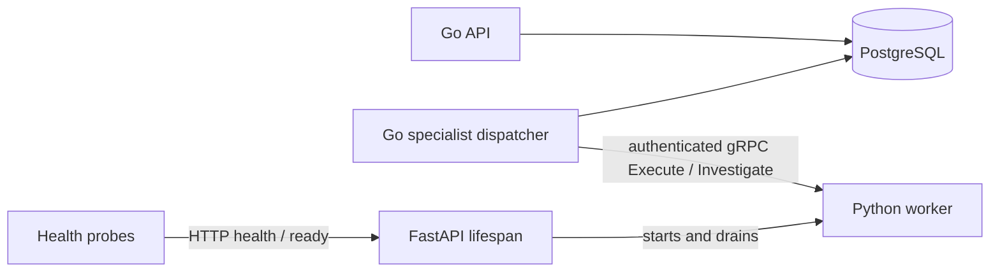

# Python FastAPI / gRPC service

An independently runnable service in the Go-first framework. Go owns orchestration,
tenant authorization, durable retries and result admission. Python has no database
or privileged response-tool credentials.

The local foundation starts this service under its supervisor (FastAPI 8001,
gRPC 50051). Demo JSON imports enter through Go, not FastAPI. Durable showcase
investigations remain explicitly mock-mode; private model endpoint configuration
enables an optional model RPC capability without silently converting demo jobs.
See [local release gates](../../docs/LOCAL_RELEASE_GATES.md) for configuration and
real-model evaluation limits, and [demo imports](../../docs/BENCHMARK_DATA_IMPORT.md).



## Start with Go development services

From the repository root:

```bash
python3 -m venv services/python-worker/.venv
services/python-worker/.venv/bin/python -m pip install --upgrade 'pip==26.2'
services/python-worker/.venv/bin/pip install -r services/python-worker/requirements.txt
python3 scripts/framework/dev.py stop
python3 scripts/framework/dev.py start --investigation-worker --python-worker
python3 scripts/framework/dev.py status
```

The launcher retains a private service credential in `.run/go-dev/settings.json`,
starts Python independently and connects the Go dispatcher to gRPC. Enabling the
option persists across development restarts. Stop with
`python3 scripts/framework/dev.py stop`; data remains intact. The initialized
release on 3002/8080 is unaffected.

## Run independently

Supply `AISOC_WORKER_TOKEN` from private environment configuration: at least 32
non-whitespace ASCII characters. Run:

```bash
services/python-worker/.venv/bin/python services/python-worker/worker.py
```

| Setting | Default | Purpose |
|---|---|---|
| `AISOC_PYTHON_ADDR` | `127.0.0.1:50051` | gRPC listener; configure the same value in Go |
| `AISOC_PYTHON_HTTP_ADDR` | `127.0.0.1:8001` | FastAPI listener |
| `AISOC_WORKER_TOKEN` | Required | Matching private service credential in Go/Python |

By default both listeners require literal loopback and different addresses.
Optional mTLS permits a specific non-loopback gRPC bind; HTTP stays local. This supports
same-host or shared-network-namespace sidecars. Remote plaintext RPC is rejected.
Use this entry point: extra Uvicorn workers/reload would compete for the gRPC port.

## Endpoints and contracts

| Interface | Behavior |
|---|---|
| HTTP `GET /health` | Process liveness; no credentials or case data |
| HTTP `GET /ready` | Actual authenticated gRPC health check; 503 on outage/saturation |
| HTTP `GET /v1/capabilities` | Bearer-authenticated plugin versions and limits |
| gRPC `grpc.health.v1.Health/Check` | Authenticated unary health for `aisoc.worker.v1.Worker` |
| gRPC `aisoc.worker.v1.Worker/Execute` | Existing versioned, bounded execution contract |
| gRPC `aisoc.worker.v1.Investigator/Investigate` | Typed evidence and investigation result; mock mode or explicitly configured model adapter |

Go executes work over gRPC; there is no HTTP execution bypass. Only
`python.normalize` version `1` is available through Worker/Execute: a trusted bounded subprocess, not an LLM
or arbitrary-code runtime. Unknown plugin versions fail closed. Inputs/outputs
preserve tenant/job/attempt/plugin identity.

Four RPCs can execute concurrently. Go imposes a five-second deadline; Python
enforces three-second child execution, 64 KiB payloads and subprocess cleanup.
Health shares the admission limit and may report not ready under load; readiness
failure alone should not trigger a process restart.

The three-second child limit applies to normalization, not model inference. Typed
investigations use their task deadline and tighter 16 KiB/16-evidence-item bounds.
The Go dispatcher defaults to two execution slots and one running lease per tenant.
Transport defaults to bearer-authenticated plaintext on literal loopback. Optional
mTLS additionally verifies CA and peer SAN identity while retaining bearer checks.
See [TLS settings, certificate lifecycle and tests](../../docs/WORKER_DISPATCH_SECURITY.md).

S07 adds a separate typed `Investigator/Investigate` RPC on the same listener,
with authenticated named health and capabilities discovery. The default `mock-v1`
returns two alternative hypotheses, supplied citations, missing evidence and an
inconclusive result requiring review. Optional `model-v1` requires the explicit
configuration below; durable showcase jobs stay mock-mode. Go owns evidence access,
job retries and QA. Neither mode provides privileged tools. Investigation execution
does not launch the normalization subprocess. See [contract and limits](../../docs/L1_INVESTIGATION.md).

## Verification

```bash
services/python-worker/.venv/bin/python -m unittest discover -s services/python-worker -v
python3 scripts/framework/check.py
```

The full check uses disposable PostgreSQL and random listener ports. It verifies
Go-to-Python outputs, credential rejection and durable dispatch alongside existing
Rust/domain tests. Provider credentials are not needed.
See [ADR 004](../../docs/adr/004-python-fastapi-grpc-service.md).

## Optional JSON inference service

`AISOC_INFERENCE_URL`, `AISOC_INFERENCE_MODEL` and optional
`AISOC_INFERENCE_CREDENTIAL_FILE` configure `model-v1` inference through the existing
typed gRPC service. Remote endpoints require HTTPS; literal loopback HTTP supports
fixtures. Responses have strict schemas, evidence citations and bounded deadlines;
Go QA still requires human review. This is a custom JSON contract, not an assertion
of compatibility with a particular vendor API. Python has no response credentials.

The showcase durable jobs remain mock-mode. Transport tests include Go-to-Python-to-
JSON-fixture round trips; a real model and analyst-labelled quality evaluation are
still required. See [adapter contracts](../../docs/INTEGRATION_ADAPTERS.md).
